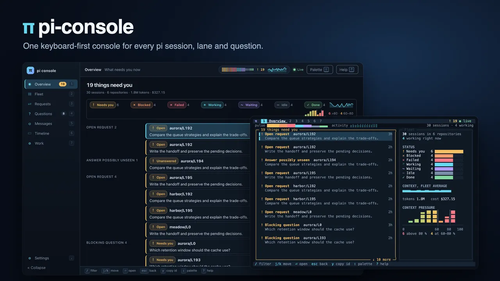
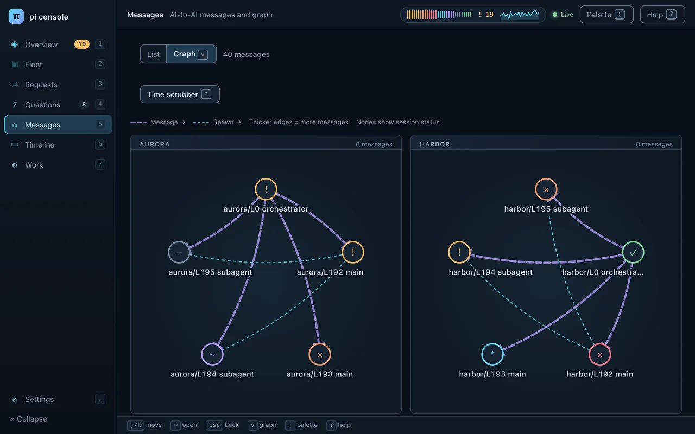
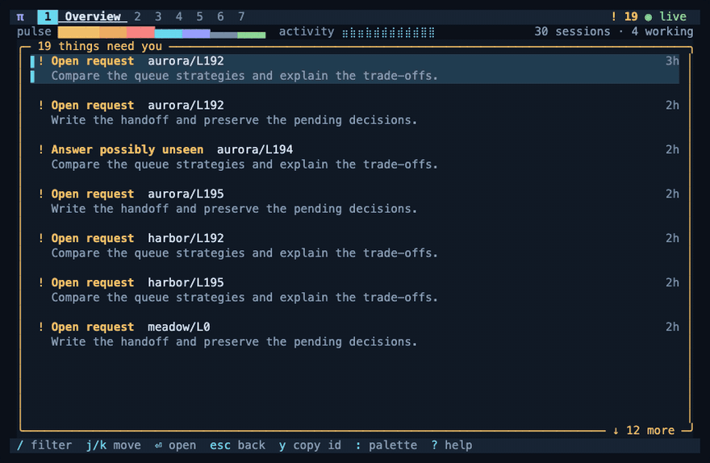
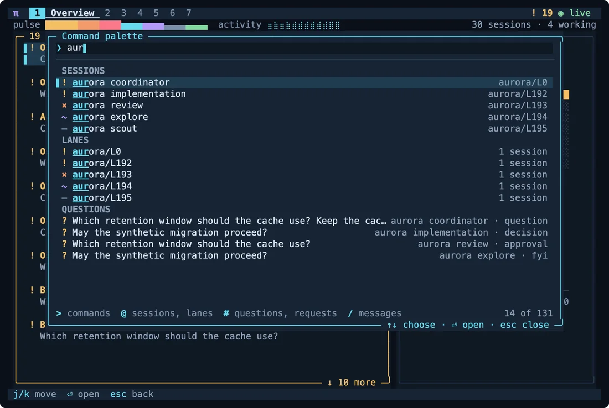
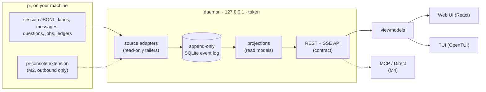

<div align="center">

<picture>
  <source media="(prefers-color-scheme: light)" srcset="docs/media/hero-light.webp">
  
</picture>

**A persistent, keyboard-first console for a local [pi](https://github.com/earendil-works/pi) setup.**<br>
Every session, lane, orchestrator, subagent, question, answer and message in one place, in a web UI and a terminal UI over the same event-sourced store.

[](https://github.com/woksin/pi-console/actions/workflows/ci.yml)


[Tour](#tour) · [Quick start](#quick-start) · [Architecture](#architecture) · [Security](#security-model) · [Docs](#documentation)

</div>

> The name `pi-console` is provisional. All pictures in this repository are generated from synthetic demo data (see [Demo data](#demo-data-and-regenerating-the-media)).

## Why

Long-running pi work is spread over many sessions and lanes, and each session resets its context many times. Two things go wrong:

1. **Answers are lost.** A reset (compaction or handoff) can drop the answer to a prompt you asked, or cut the session off mid-prompt, and you never get the result.
2. **Nothing shows the whole picture.** Truth is spread over roughly ten file stores (session JSONL, lane registry, message files, question store, job logs, queue ledgers). No view says which session needs you, which is stuck, and which request is still unanswered.

In a recent study of 33 days of local sessions, 657 sessions had at least one context reset, 95 had ten or more, and one orchestrator session had 136 [context-memory study, final report §2]. pi-console is the human-facing half of the fix: a durable view that never loses a request or an answer.

## Tour

### Needs you first

The Overview opens on what needs a human: open requests, answers you may not have seen, blocking questions, blocked lanes. The header's **fleet pulse** and the **context-pressure histogram** show the whole fleet at a glance, and the tab title carries the count.

<picture>
  <source media="(prefers-color-scheme: light)" srcset="docs/media/web-overview-light.webp">
  
</picture>


### Fleet

Sessions, lanes, orchestrators and subagents with fixed status semantics, so a glyph and colour always mean the same thing in both clients.


### Resets, shown where they happen

Every context reset is an inline `⟲` divider in the transcript: what kind it was, which requests were **carried over** and which were **interrupted**. Nothing is lost silently.

<picture>
  <source media="(prefers-color-scheme: light)" srcset="docs/media/web-session-resets-light.webp">
  
</picture>

### Command palette

`Ctrl+P` or `:` opens a palette with typed groups (commands, sessions, lanes, questions). `>` filters to commands, `@` to sessions and lanes, `#` to questions and requests, `/` to messages.


### Keyboard tour

Everything is reachable from the keyboard: `1`-`7` switch views, `j`/`k` move, `Enter` opens, `Esc` goes back, `?` shows the map.


### Timeline and graph

One time axis for requests, answers, resets, questions and messages; and a messages graph of who talked to whom, nodes coloured by status.




### Themes

Midnight (default), dawn and high contrast, with a live preview in Settings. Status never relies on colour alone: every status has a glyph.


### Every web view, both themes

| View | Midnight (dark) | Dawn (light) |
|---|---|---|
| Overview | [Screenshot](docs/media/web-overview.webp) | [Screenshot](docs/media/web-overview-light.webp) |
| Fleet | [Screenshot](docs/media/web-fleet.webp) | [Screenshot](docs/media/web-fleet-light.webp) |
| Requests | [Screenshot](docs/media/web-requests.webp) | [Screenshot](docs/media/web-requests-light.webp) |
| Questions | [Screenshot](docs/media/web-questions.webp) | [Screenshot](docs/media/web-questions-light.webp) |
| Messages list | [Screenshot](docs/media/web-messages.webp) | [Screenshot](docs/media/web-messages-light.webp) |
| Messages graph | [Screenshot](docs/media/web-graph.webp) | [Screenshot](docs/media/web-graph-light.webp) |
| Timeline | [Screenshot](docs/media/web-timeline.webp) | [Screenshot](docs/media/web-timeline-light.webp) |
| Work | [Screenshot](docs/media/web-work.webp) | [Screenshot](docs/media/web-work-light.webp) |
| Session detail | [Screenshot](docs/media/web-session.webp) | [Screenshot](docs/media/web-session-light.webp) |
| Settings | [Screenshot](docs/media/web-settings.webp) | [Screenshot](docs/media/web-settings-light.webp) |

### The terminal UI

The same views, models and keymap in a terminal. It runs on [OpenTUI](https://github.com/sst/opentui) and talks to the daemon over the same loopback API.



A [VHS tape](scripts/media/tui.tape) also records the real TUI against the isolated demo daemon:





It also has a **mono** theme (`PI_CONSOLE_THEME=mono`, or `NO_COLOR`) where status is carried by glyphs and weight only:


## Quick start

Requires Node.js 26 or newer.

```bash
npm ci
```

### Try it

```bash
npm run demo
```

This builds the web bundle, generates synthetic data and starts the **real daemon** on a free loopback port. Nothing is read from your pi directories and no live agents are connected. Open the printed web URL, then paste the contents of the printed token file into the connection screen. The token is never printed or included in the URL. The launcher also prints a command for opening the TUI in a second terminal against the same daemon.

Press **Ctrl-C** in the demo terminal to stop it and remove its temporary data and token. Each run starts fresh. The synthetic event log is static; the separate developer mock remains available with `npm start`.

**Run it on your own pi data** (read-only by default; it reads `~/.pi/agent` and keeps its own store in `~/.pi-console`):

```bash
npm run build -w @pi-console/web
node packages/cli/bin/pi-console.mjs daemon --web-dist packages/web/dist   # prints the URL; the token is ~/.pi-console/token
node packages/cli/bin/pi-console.mjs tui                                    # in a second terminal
```

Memory review is a narrow opt-in exception: with daemon review enabled, a separate `memory-control-token` and a ready owning interactive pi provider, both consoles can request **Confirm…** / **Reject…**. Every request requires native human confirmation in pi and then canonical producer ingestion; the console never writes memory directly. The ordinary token remains read-only, with exact command fallback and reasons when review is unavailable. See [web memory review](docs/ui-web.md#memory-review) and [TUI memory review](docs/ui-tui.md#memory-review) for credential setup and controls.

`pi-console daemon --help` lists the data directory, port and source options. Interventions (answering, steering, pausing) are milestone M2; there is no global install yet.

CLI errors print a short message to stderr and exit non-zero. Set `PI_CONSOLE_DEBUG=1` to include a stack trace for diagnosis (for example, `PI_CONSOLE_DEBUG=1 pi-console daemon --port banana`).

## Architecture



Everything is derived from the append-only event log, so every screen can be rebuilt by replay. Packages (`packages/`): `contract` (schemas and shared types), `core` and `adapters` (sources, ingestion, projections), `daemon`, `viewmodels` (what both clients render), `web`, `tui`, `cli`, `testkit` (mock daemon and synthetic fixture). Details: [docs/architecture.md](docs/architecture.md).

## Security model

pi sessions can run shell commands and hold credentials, so the console treats its own surface as hostile territory. The full threat model is in [docs/security.md](docs/security.md) and [ADR-0006](docs/adr/0006-security-model.md).

- **Loopback only.** The daemon binds `127.0.0.1`; a Host allowlist and an Origin check (plus a CSRF header for writes) defend against DNS rebinding and cross-site requests.
- **Token on every request.** A 256-bit random token in an owner-only (0600) file, removed from the URL after exchange, `HttpOnly` cookie, rotation and scoped read-only tokens.
- **Strict CSP.** The web bundle is served with a strict Content-Security-Policy and no external network.
- **Transcripts are untrusted text.** Model and attacker-written content is rendered as text, never HTML; control sequences are stripped in the TUI.
- **Read-only in M1.** No intervention path exists yet; later writes are typed commands with an audit trail.
- **Secrets are redacted** at ingestion (fail closed) and again on return.

## Demo data and regenerating the media

All demo data is synthetic: `npm run generate` rebuilds the fixture used by the media pipeline and demo launcher. `npm run media` regenerates `docs/media/`, including every main web view in midnight and dawn and the [VHS terminal recording](scripts/media/tui.tape). It needs Chromium, `ffmpeg` and `cwebp`; VHS additionally needs `vhs` and `ttyd`. Without VHS, the terminal recording falls back to the existing PTY frame capture and says so. See [docs/media/README.md](docs/media/README.md) for commands, the shot list, budget and determinism notes. Media generation is manual, not part of CI.

## Status

| Milestone | Scope | State |
|---|---|---|
| M0 | Spikes and visual bake-off | Spikes complete; results are in the ADRs |
| M1 | Read-only console (web and TUI) over the daemon | In progress; both UIs, the daemon and the contract exist |
| M2 | Live transcript and interventions | Planned |
| M3 | Remote access and self-host | Planned |
| M4 | MCP server and Direct adapter | Planned |
| M5 | Learning and polish | Planned |

Acceptance criteria per milestone: [docs/milestones.md](docs/milestones.md).

## Documentation

| Document | Content |
|---|---|
| [docs/index.md](docs/index.md) | Table of contents and reading order |
| [docs/vision.md](docs/vision.md) | Problem, vision, principles, personas, non-goals |
| [docs/information-architecture.md](docs/information-architecture.md) | Entities, navigation, status taxonomy, screens, keyboard map, visual style |
| [docs/ui-web.md](docs/ui-web.md) | Running the web console, its keyboard map and security model |
| [docs/ui-tui.md](docs/ui-tui.md) | The terminal UI: keys, structure, tests |
| [docs/event-model.md](docs/event-model.md) | Event catalogue, projections, idempotency, privacy |
| [docs/architecture.md](docs/architecture.md) | Components, process model, packages, data directories, testing |
| [docs/api/v1.md](docs/api/v1.md) | The daemon API |
| [docs/security.md](docs/security.md) | Threat model and controls |
| [docs/milestones.md](docs/milestones.md) | M0 to M5 with acceptance criteria |
| [docs/research-summary.md](docs/research-summary.md) | Research findings with sources |
| [docs/adr/](docs/adr/) | Architecture decision records |
| [docs/media/README.md](docs/media/README.md) | The shot list and how the pictures are generated |

## License

License: to be announced.
