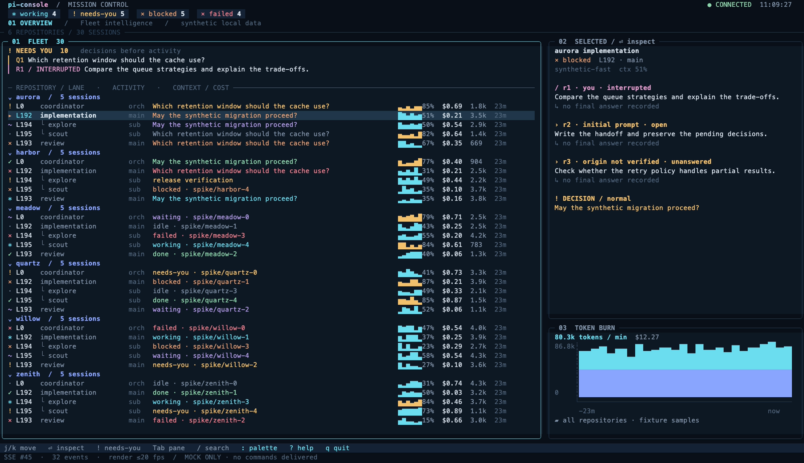

# TUI bake-off (M0): results and recommendation

Status: round 1 inconclusive on the first two criteria; round 2 (OpenTUI vs Bubble Tea v2, signature views) decides. Owner reviews the result ([ADR-0003](../adr/0003-tui-stack-bake-off.md)).

Three candidates built the same two screens (fleet overview and session detail with a live streaming transcript) against the same mock daemon and the same visual spec. Criteria, in order: visual quality, then UX and interaction quality, then everything else.

## Fleet overview at 200x50

| OpenTUI (React renderer) | Bubble Tea v2 + Lip Gloss v2 | pi-tui |
|---|---|---|
|  |  |  |

Session detail: [OpenTUI](../../spikes/tui-opentui/session-200.png), [Bubble Tea](media/tui-bubbletea-detail-200x50.png), [pi-tui](media/tui-pitui-detail-200x50.png). Recordings: [OpenTUI](../../spikes/tui-opentui/demo.gif), [Bubble Tea](media/tui-bubbletea-navigation.gif), [pi-tui](media/tui-pitui-demo.gif).

## Results

| | OpenTUI 0.9.6 | Bubble Tea v2 | pi-tui |
|---|---|---|---|
| Visual quality (orchestrator's judgement from the screenshots) | High | High | High |
| Interaction built in the spike | Per-block expand by click, panes stack below 100 columns, frozen paused scrollback | Global expand only, rail hidden below 100 columns, 1.2 s row fade on change, theme switch | Independent block expansion, gradient wordmark, 350 ms row highlight (not a smooth fade), bounded tail |
| Implementer self-score (visual / UX) | see spike README | 8 / 8 | 8 / 7.5 |
| CPU while streaming 5,000 entries/s (mean) | 16.9% | 17.1% | 19.9% (peak 41.9%) |
| Memory (peak RSS) | 269 MiB | 29 MiB | 283 MiB |
| Runtime and distribution | Node 26.8+ with `--experimental-ffi`, platform-native binaries, pre-1.0 | Single native executable (~11 MiB), no runtime | npm, Node ≥ 26 (spike), not a single binary |
| Shares TypeScript with the web UI | Yes (React) | No (Go client of the daemon API) | Yes |
| Maturity | Pre-1.0; experimental Node FFI | v2 stable since Feb 2026 | Tied to pi's release cadence |

## Findings

1. **Static look is close.** Given the same spec, all three reached a similar look: dense rows, block sparklines, amber "needs you", coloured status pills and a fleet burn chart. Similar styling does not prove a tie on visual ceiling or UX.
2. **Demonstrated interaction favours OpenTUI** (per-block disclosure, narrow-pane stacking, frozen paused scrollback), although part of that difference may come from each implementer's choices rather than the library.
3. **Footprint, distribution and maturity favour Bubble Tea**: about a tenth of the memory, one binary with no runtime, stable v2. OpenTUI needs an experimental Node flag and native artefacts, and is pre-1.0. pi-tui is the heaviest under load. These rank third in the criteria.
4. **Unverified for Bubble Tea:** generating a Go HTTP + SSE client from the API's JSON Schemas (schemas alone do not give transport), the cost of a Go + TypeScript repository for contributors, and npm distribution of per-platform binaries (including optional-dependency failure paths).

## Decision path: round 2

pi-tui is dropped from the standalone race (heaviest under load, smallest widget set); it remains the library for the in-pi panel. OpenTUI and Bubble Tea v2 each build, against the same mock daemon:

- the **swimlane timeline** (all sessions over time, reset markers, requests and answers) and the **AI communication graph** (lanes, orchestrators and subagents as nodes, messages as animated edges), with motion;
- per-block disclosure, narrow-pane stacking and the intervention composer overlay;
- a distribution proof: OpenTUI packaged for `npx`/global npm install; Bubble Tea with a generated or schema-checked Go client plus an npm wrapper with per-platform optional dependencies.

The winner is chosen on visual quality, then UX, then the rest, with the recordings reviewed by the owner.

The in-pi panel ([ADR-0003](../adr/0003-tui-stack-bake-off.md), option c) is a separate small piece that must use pi's own TUI. It stays pi-tui regardless of the standalone stack.

## Gaps carried into M1

- Code Health exceptions in all three spikes; spike code is not carried forward as is.
- Root `npm run check` fails on the Arc spike's generated proxies (`spikes/arc-ts/client/generated/All.ts`, TypeScript parameter properties under strip-only mode). Fix in M1.
- API v0 gaps found by the clients: structured tool results (success or failure), and a request link on each user transcript entry.
