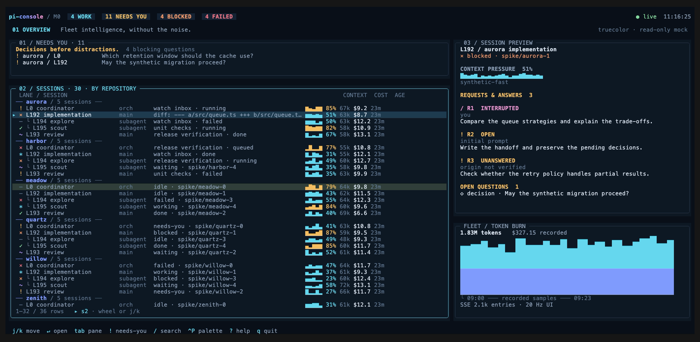
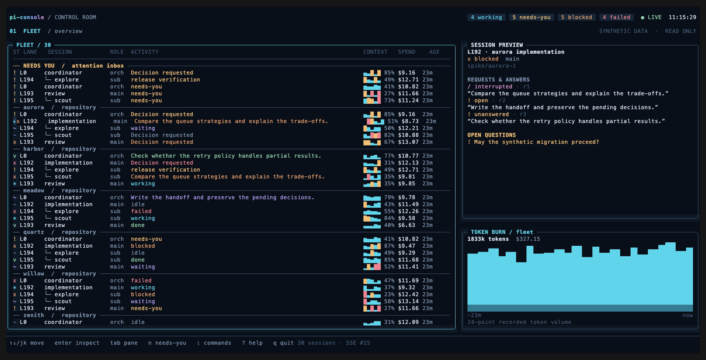
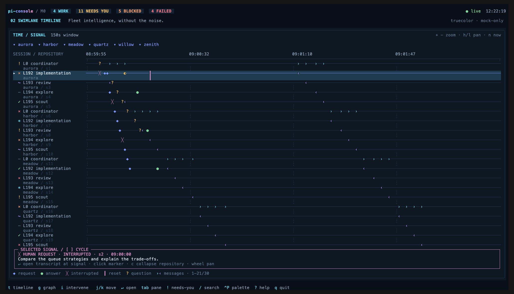
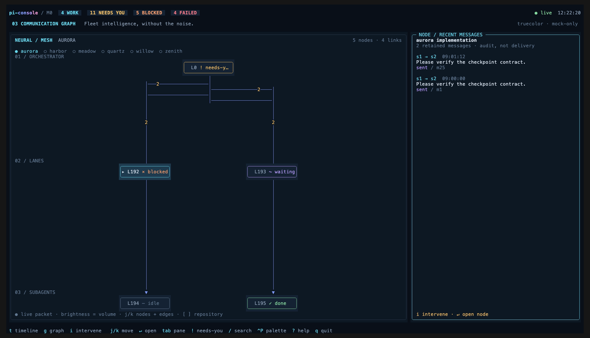
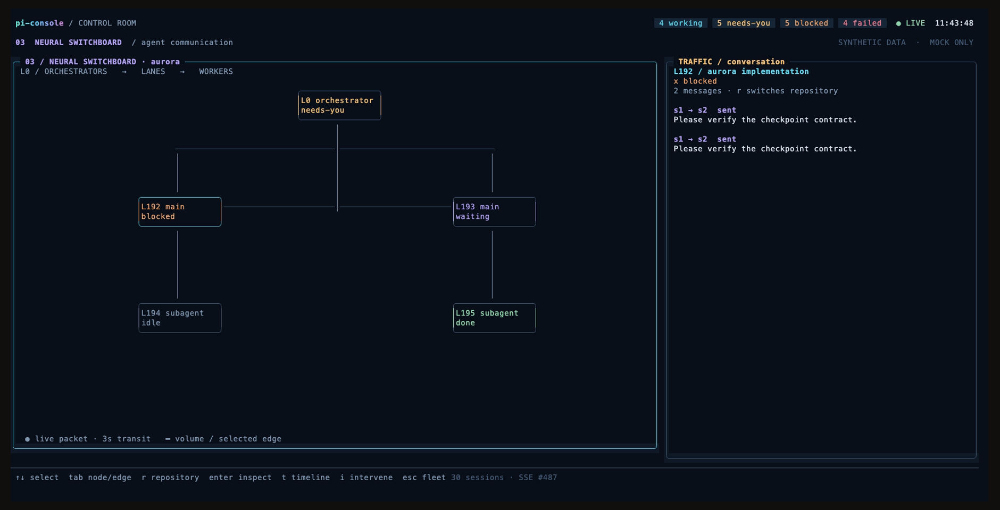

# TUI bake-off (M0): results and recommendation

Status: round 2 complete. Recommendation: **OpenTUI** for the standalone TUI, pending owner review of the media ([ADR-0003](../adr/0003-tui-stack-bake-off.md)). Round 1 was inconclusive on the first two criteria; see [Round 2](#round-2-signature-views).

Three candidates built the same two screens (fleet overview and session detail with a live streaming transcript) against the same mock daemon and the same visual spec. Criteria, in order: visual quality, then UX and interaction quality, then everything else.

## Fleet overview at 200x50

| OpenTUI (React renderer) | Bubble Tea v2 + Lip Gloss v2 | pi-tui |
|---|---|---|
|  |  |  |

Session detail: [OpenTUI](../../spikes/tui-opentui/session-200.png), [Bubble Tea](media/tui-bubbletea-detail-200x50.png), [pi-tui](media/tui-pitui-detail-200x50.png). Recordings: [OpenTUI](../../spikes/tui-opentui/demo.gif), [Bubble Tea](media/tui-bubbletea-navigation.gif), [pi-tui](media/tui-pitui-demo.gif).

## Results

| | OpenTUI 0.9.6 | Bubble Tea v2 | pi-tui |
|---|---|---|---|
| Visual quality (orchestrator's judgement from the screenshots) | High | High | High |
| Interaction built in the spike | Per-block expand by click, panes stack below 100 columns, frozen paused scrollback | Global expand only, rail hidden below 100 columns, 1.2 s row fade on change, theme switch | Independent block expansion, gradient wordmark, 350 ms row highlight (not a smooth fade), bounded tail |
| Implementer self-score (visual / UX) | see spike README | 8 / 8 | 8 / 7.5 |
| CPU while streaming 5,000 entries/s (mean) | 16.9% | 17.1% | 19.9% (peak 41.9%) |
| Memory (peak RSS) | 269 MiB | 29 MiB | 283 MiB |
| Runtime and distribution | Node 26.8+ with `--experimental-ffi`, platform-native binaries, pre-1.0 | Single native executable (~11 MiB), no runtime | npm, Node ≥ 26 (spike), not a single binary |
| Shares TypeScript with the web UI | Yes (React) | No (Go client of the daemon API) | Yes |
| Maturity | Pre-1.0; experimental Node FFI | v2 stable since Feb 2026 | Tied to pi's release cadence |

## Findings

1. **Static look is close.** Given the same spec, all three reached a similar look: dense rows, block sparklines, amber "needs you", coloured status pills and a fleet burn chart. Similar styling does not prove a tie on visual ceiling or UX.
2. **Demonstrated interaction favours OpenTUI** (per-block disclosure, narrow-pane stacking, frozen paused scrollback), although part of that difference may come from each implementer's choices rather than the library.
3. **Footprint, distribution and maturity favour Bubble Tea**: about a tenth of the memory, one binary with no runtime, stable v2. OpenTUI needs an experimental Node flag and native artefacts, and is pre-1.0. pi-tui is the heaviest under load. These rank third in the criteria.
4. **Unverified for Bubble Tea:** generating a Go HTTP + SSE client from the API's JSON Schemas (schemas alone do not give transport), the cost of a Go + TypeScript repository for contributors, and npm distribution of per-platform binaries (including optional-dependency failure paths).

## Decision path: round 2

pi-tui is dropped from the standalone race (heaviest under load, smallest widget set); it remains the library for the in-pi panel. OpenTUI and Bubble Tea v2 each build, against the same mock daemon:

- the **swimlane timeline** (all sessions over time, reset markers, requests and answers) and the **AI communication graph** (lanes, orchestrators and subagents as nodes, messages as animated edges), with motion;
- per-block disclosure, narrow-pane stacking and the intervention composer overlay;
- a distribution proof: OpenTUI packaged for `npx`/global npm install; Bubble Tea with a generated or schema-checked Go client plus an npm wrapper with per-platform optional dependencies.

The winner is chosen on visual quality, then UX, then the rest, with the recordings reviewed by the owner.

The in-pi panel ([ADR-0003](../adr/0003-tui-stack-bake-off.md), option c) is a separate small piece that must use pi's own TUI. It stays pi-tui regardless of the standalone stack.

## Round 2: signature views

Both candidates built the swimlane timeline, the communication graph with animated packets, per-block disclosure, narrow-pane stacking and the intervention composer against the same mock daemon, plus a distribution proof. Full reports: [OpenTUI](tui-bake-off-opentui.md), [Bubble Tea](tui-bubbletea-r2.md).

### Timeline at 200 columns

| OpenTUI | Bubble Tea v2 |
|---|---|
|  |  |

### Communication graph at 200 columns

| OpenTUI | Bubble Tea v2 |
|---|---|
|  |  |

Composer: [OpenTUI](../../spikes/tui-opentui/composer-200.png), [Bubble Tea](media/r2-bubbletea-composer-200x50.png). Narrow layout: [OpenTUI 120](../../spikes/tui-opentui/edge-120.png), [Bubble Tea 90x30](media/r2-bubbletea-stacked-90x30.png). Recordings: [OpenTUI signature tour](../../spikes/tui-opentui/signature-tour.gif) (34 s), [Bubble Tea motion](media/r2-bubbletea-motion.gif).

### Round 2 results

| | OpenTUI | Bubble Tea v2 |
|---|---|---|
| Timeline | Selected-row band, signal detail card, click a marker to select, wheel pan, zoom, collapse per repository | Grouped by repository with headings, marker cycling, zoom and pan, replay-now line; keyboard only |
| Graph | Three layers, packets with volume brightness, edge conversation pane; edge routes share segments and read as doubled lines | Three layers, cleaner orthogonal routes, packets and edge conversation; overlapping routes on denser graphs |
| Disclosure and layout | Independent per-block disclosure by key or click; flexbox layout, panes stack below 100 columns | Per-block disclosure; stacking below 100 columns; docked preview partial |
| Motion | Renderer animation engine used across views (about 20 frames/s) | Harmonica springs in the composer only; packet animation hand-built |
| Mouse | Click and wheel across views | Click and wheel; no drag or hover |
| Load at `--rate 5000`, graph visible (mean CPU, mean RSS) | 27.2%, 188 MiB (120x40, also exercises timeline and palette) | 13.4%, 29 MiB (120x36) |
| Distribution proof | Fresh production-only npm tarball install and launch on macOS | Generated Go types plus live conformance test; npm wrapper with three platform packages, macOS installed |
| Cross-platform | Unverified | Linux and Windows packages built, not run |
| Code Health | Five files below 9.5 (spike exception) | Pre-commit safeguard failed (spike exception) |

The headline "needs you" counts differ (OpenTUI 11, Bubble Tea 5) because OpenTUI counts sessions with a blocking open question or an unanswered request as well as `needs-you` status. M1 defines attention once, in the daemon.

### Recommendation

**OpenTUI.** Static look stays close; both are polished. The decision rests on the UX ceiling, which is what the owner asked for ("cool", excellent UX, special tools):

1. OpenTUI's layout engine, hit testing and animation engine made the richer interactions (clickable timeline markers, selected-row bands, detail cards, motion across views) cheap. The Bubble Tea report names compositing, hit testing, collision-free routing and responsive sizing as manual work, and motion stopped at the composer.
2. OpenTUI shares React and TypeScript with the web UI, so view models, API types and formatting are written once.
3. The costs rank third but are real: about 6x the memory and twice the CPU of Bubble Tea, Node with `--experimental-ffi`, native per-platform binaries and a pre-1.0 library. M1 contains them by pinning the OpenTUI version, keeping the renderer behind a thin view layer over shared view models, and proving Linux install before the first release.

Bubble Tea stays the fallback if OpenTUI's native distribution fails on Linux or the library breaks across pinned upgrades. Its graph routing is the better reference for M1's graph layout.

## Gaps carried into M1

- Code Health exceptions in all spikes; spike code is not carried forward as is.
- Graph edge routing (shared segments read as doubled lines) and exact timeline marker positions (OpenTUI uses the nearest retained transcript timestamp).
- A single daemon-side definition of "needs you".
- Root `npm run check` fails on the Arc spike's generated proxies (`spikes/arc-ts/client/generated/All.ts`, TypeScript parameter properties under strip-only mode). Fix in M1.
- API v0 gaps found by the clients: structured tool results (success or failure), and a request link on each user transcript entry.
