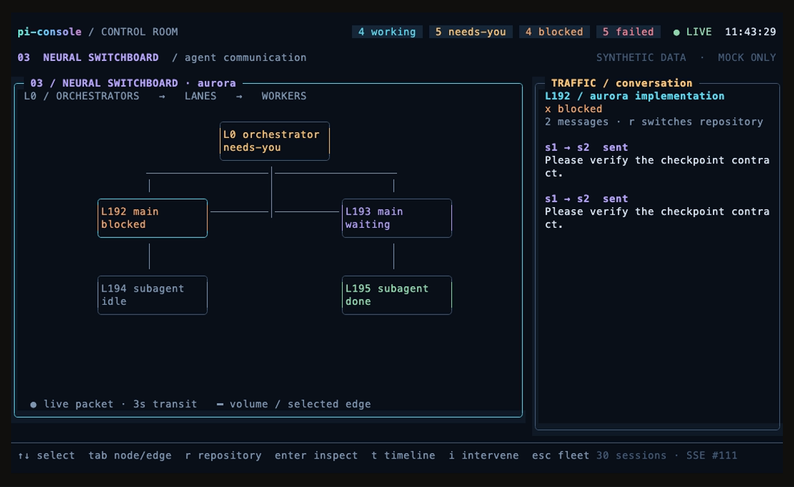
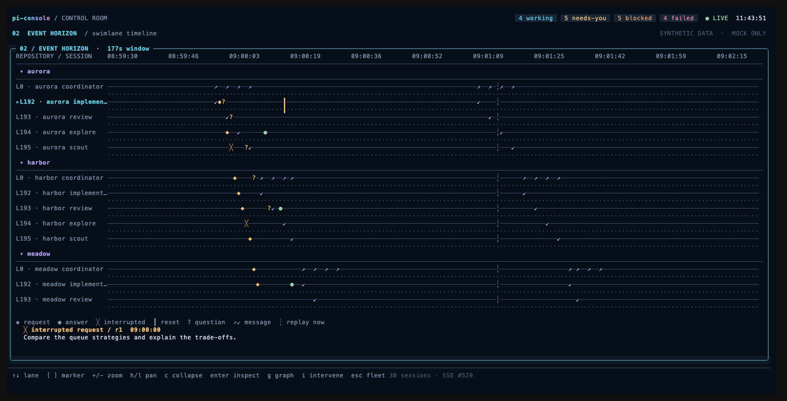
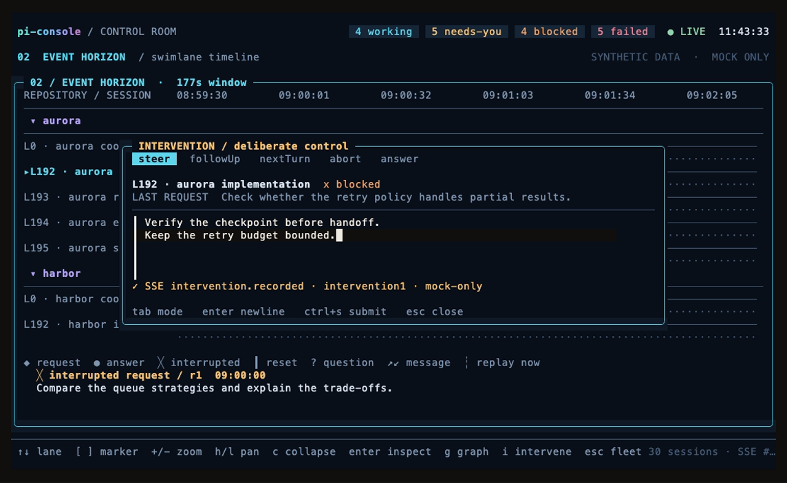
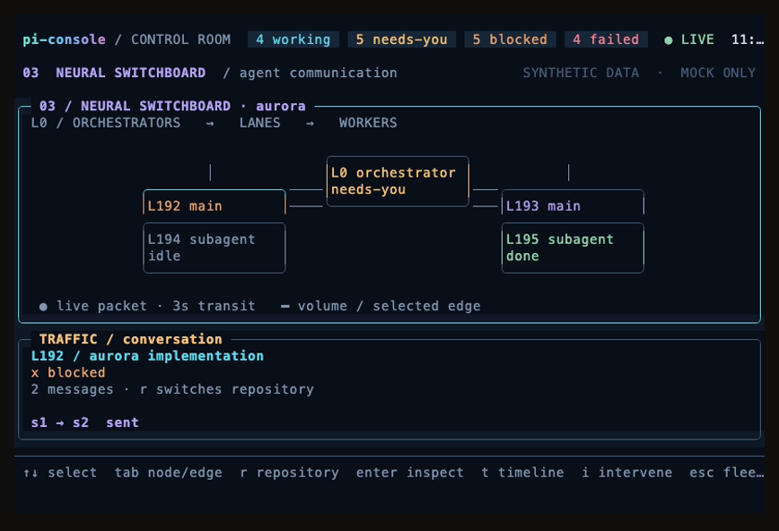
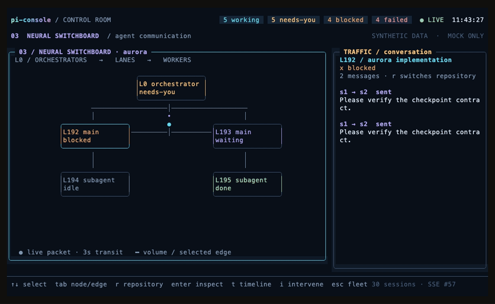

# Bubble Tea — round 2

**Local-only spike, not a production recommendation.** Visual **7.5/10**, UX **7/10**. The muted control-room palette, outlined nodes, replay horizon and compact intervention surface are cohesive. Purpose-built views are substantially more useful than the round-1 fleet table. Edge routing still feels diagrammatic rather than polished, marker collisions need better handling, and keyboard discoverability remains work.

## Built

- `t`: **Event Horizon**. Repository groups, collapsible session lanes, time labels, centered bounded zoom (`+/-`), pan (`h/l`, mouse wheel), request/answer/interrupted/question/message glyphs, two-row reset dividers and an SSE-driven replay cursor. `↑↓` selects lanes, `[/]` selects events; the docked detail strip previews the marker; Enter opens the matching session at its nearest transcript timestamp. Click group headers or markers.
- `g`: **Neural Switchboard**. One repository at a time (`r` cycles), orchestrator / lane / subagent layers, status-colored boxes, message-volume brightness, orthogonal message edges. Actual `message.sent` arrivals start a three-second cyan packet with a violet trail at 20 Hz. `↑↓` selects nodes; Tab switches to edge selection and its two-party conversation. Nodes and edges are clickable.
- Transcript: `[/]` block cursor, Space or click independently discloses thinking, tool calls and tool results. Pausing copies the current retained transcript; subsequent arrivals, delta coalescing and retention eviction cannot mutate that frozen buffer. `f` resumes. Below 100 columns, transcript and inspector, fleet and preview, and graph and conversation **stack**, rather than dropping the second pane.
- `i`: multiline composer on the selected session, with steer / follow-up / next-turn / abort / answer tabs, last-request and status preview, lane-ID confirmation for abort, session-owned open question lookup for answer, authenticated POST, then acknowledgement from `intervention.recorded`. Ctrl+S submits; Enter inserts a newline. Clearly labeled mock-only.
- Existing SSE row-highlight fades remain; Harmonica spring-eases composer entry. The palette includes the new screens and composer. `--screen` supports reproducible startup views.

## Captures

All captures run the **globally installed npm wrapper**, in real VHS PTYs. The sizes below are logical terminal columns × rows, including the stacked 90-column case; PNGs include terminal padding. `spikes/tui-bubbletea/r2.tape` is the reference tape. `r2-capture.mjs` generates the three exact size-specific tapes under `.ai-work/tasks/m0r2-bubbletea/output/` and runs them against its own unchanged private mock. Nothing is published.

| View | 120×36 | 200×50 |
|---|---|---|
| Timeline | [PNG](media/r2-bubbletea-timeline-120x36.png) | [PNG](media/r2-bubbletea-timeline-200x50.png) |
| Graph | [PNG](media/r2-bubbletea-graph-120x36.png) | [PNG](media/r2-bubbletea-graph-200x50.png) |
| Composer, submitted audit | [PNG](media/r2-bubbletea-composer-120x36.png) | [PNG](media/r2-bubbletea-composer-200x50.png) |
| Expanded transcript | [PNG](media/r2-bubbletea-transcript-120x36.png) | [PNG](media/r2-bubbletea-transcript-200x50.png) |







GIF: **8.44 seconds, 487,081 bytes**, under both limits. Capture command, from repository root:

```sh
PI_BUBBLETEA_BIN=.ai-work/tasks/m0r2-bubbletea/output/npm/prefix/bin/pi-console-bubbletea \
  node spikes/tui-bubbletea/r2-capture.mjs
```

## Performance

`node spikes/tui-bubbletea/measure.mjs` — exit **0**. Unchanged daemon at `--rate 5000` equivalent (`startDaemon({rate:5000})`), graph visible in a 120×36 PTY, one `ps` sample per second for 20 seconds. **Mean CPU 13.37%, peak 15.7%; mean RSS 28.67 MiB, peak 29.09 MiB.** CPU is the macOS process `%cpu` estimate, not whole-machine usage; RSS excludes daemon, wrapper and VHS/Chromium. The harness retains samples in `.ai-work/tasks/m0r2-bubbletea/output/measure.json`. This measures the sustained high-rate transcript stream while the graph renders and live message pulses are available, not 5,000 graph packets per second.

## Generated API and distribution proof

`node generate.mjs` generates `api/generated.go` directly from `docs/api/schemas/api.json` (the shared `$defs` used by the schema entrypoints). No external generator installation. `--check` detects stale output. Generated transport structs cover all response types and each discriminated event payload; handwritten UI structs remain deliberately smaller projections. This generator maps the schema's current vocabulary; it does **not** implement runtime enum, required-field or numeric-bound validation.

The opt-in live Go conformance test starts an unchanged, private loopback daemon. It strictly decodes all GET responses (all session details and transcripts, all three request filters, overview, sessions, questions, messages, jobs); decodes all **11** SSE variants into generated payload types; POSTs all **five** intervention variants and requires the resulting stream audit. It passed. The root schema tests independently validate the daemon's full JSON Schema constraints.

`npm/` is an esbuild-style main package with three optional platform dependencies, a forwarding launcher, explicit unsupported-platform / missing-binary diagnostics, and no install scripts or runtime downloads. Node **>=22** is the wrapper floor; the Go executable itself needs no Node. The mock uses Node's built-in TypeScript stripping; this run used Node 26.8.1. There are no published packages: install the platform tarball beside the main tarball for this local proof.

Build command (exit **0**), from root:

```sh
~/.pi/agent/bin/pi-phase run --kind build --policy fast \
  --label m0r2-bubbletea-matrix --timeout 300 -- \
  sh -c 'cd spikes/tui-bubbletea && gofmt -w ./*.go && node npm/build.mjs'
```

`npm/build.mjs` runs `CGO_ENABLED=0 GOOS=<target> GOARCH=<arch> go build -trimpath -ldflags='-s -w'`, then `npm pack` for each package and the main wrapper.

| Target | Binary bytes | Proof |
|---|---:|---|
| darwin-arm64 | 8,508,626 | Built, packed, globally installed, help executed; all final captures run through installed launcher |
| linux-x64 | 8,970,400 | Cross-built and packed; **not executed** |
| win32-x64 | 9,281,536 | Cross-built and packed; **not executed** |

Install/help command (exit **0**), wrapped in `pi-phase run --kind build --policy fast --label m0r2-bubbletea-install --timeout 300 -- sh -c '<below>'`:

```sh
out="$PWD/.ai-work/tasks/m0r2-bubbletea/output/npm"
npm i -g --offline --prefix "$out/prefix" --ignore-scripts --no-audit --no-fund \
  "$out/pi-console-spike-bubbletea-darwin-arm64-0.0.0-r2.tgz" \
  "$out/pi-console-spike-bubbletea-0.0.0-r2.tgz"
"$out/prefix/bin/pi-console-bubbletea" -h
```

Wrapper unit tests cover unsupported platforms, missing optional binaries, matrix selection, argument forwarding and Windows suffixes. Platform binaries/tarballs/prefix remain ignored work artifacts, not checked-in megabytes.

## Checks

- Candidate unit iteration: `~/.pi/agent/bin/pi-phase run --kind test --policy direct --label m0r2-bubbletea --timeout 300 -- sh -c 'cd spikes/tui-bubbletea && gofmt -w ./*.go && go test ./...'` — **0** after fixes. New tests cover zoom/pan/collapse/jump, graph selection/pulses, composer POST/audit/abort, per-block click disclosure, frozen retention eviction, and dimensions at 120×36, 200×50, 90×30 and 60×18.
- **Tier 1 attempted:** `~/.pi/agent/bin/pi-phase run --kind test --policy direct --label m0r2-bubbletea --timeout 300 -- sh spikes/tui-bubbletea/check.sh` — **1**, solely at the documented existing root `npm run check` failure in `spikes/arc-ts/client/generated/All.ts:16` (TypeScript parameter property unsupported in strip-only mode). Before that failure: generated freshness, gofmt, `go build -trimpath ./...`, `go vet ./...`, `go test -race ./...`, JS/shell syntax, and three wrapper tests all passed. No unrelated fix. The repository has no CI workflow to reproduce beyond its native checks; a fully green whole-repository gate is **not claimed**.
- **Tier 2:** `~/.pi/agent/bin/pi-phase run --kind test --policy direct --label m0r2-bubbletea-integration --timeout 300 -- sh -c 'npm test && cd spikes/tui-bubbletea && PI_CONFORMANCE=1 go test -run TestLiveGeneratedConformance -v .'` — **0**: nine fixture/HTTP/SSE/security/integration tests plus live generated conformance. Executed separately because the known root syntax failure stops `check.sh` before its integration step.
- Final `node --check spikes/tui-bubbletea/r2-capture.mjs`, media reproduction through the installed launcher, `ffprobe` limits, and `git diff --check` passed. Linux/Windows execution could not be checked on this Mac.

## Code Health

One scoring pass; no score-driven fix loops. Baselines were not systematically recorded (new files have no baseline). `timeline.go` had an initial review at 8.38; a focused extraction did not improve its final score. Files below 9.5 are explicit uplift work, not silently represented as meeting the threshold; the spike brief permits reporting these misses. Generated code is excluded from refactoring. The final `pre_commit_code_health_safeguard` checked 19 eligible files and **failed** its quality gate, reporting complexity regressions/introduced findings (notably model dispatch, graph/timeline rendering and keyboard dispatch). This is an explicit spike exception, not a clean Code Health result.

| Changed source | Before | After |
|---|---:|---:|
| timeline.go | 8.38 initial review | 8.22 |
| graph.go | new | 7.36 |
| composer.go | new | 9.44 |
| disclosure.go | new | 8.35 |
| data.go | not measured | 9.66 |
| detail.go | not measured | 8.80 |
| fleet.go | not measured | 7.41 |
| model.go | not measured | 8.68 |
| input.go | not measured | 7.96 |
| main.go | not measured | 9.68 |
| overlay.go | not measured | 10.00 |
| generate.mjs | new | 9.68 |
| measure.mjs | not measured | 10.00 |
| r2-capture.mjs | new | 10.00 |
| signature_test.go | new | 8.83 |
| conformance_test.go | new | 8.65 |
| model_test.go | not measured | 9.09 |
| npm/build.mjs | new | no score returned |
| npm/cli.cjs, npm/cli.test.cjs | new | unsupported `.cjs` extension |

## Partial work / API gaps

- The marker preview is a **docked detail strip**, not a floating popover. Dense marker collisions overwrite a cell; zoom is the workaround. Mouse drag/hover selection is not implemented (wheel and click are).
- Graph is intentionally one repository at a time; it does not show off-repository edges. Routes can overlap; brightness is a two-level volume cue, not proportional edge thickness. There is no graph pan/zoom or force-directed simulation.
- The replay cursor uses entity timestamps from SSE, not wall time: fixtures are dated independently of emission time, and the API supplies no replay playhead. It can leave the window; pan/zoom manually. Snapshot data includes events later than the current replay position.
- Answer mode chooses the first open question belonging to the session; there is no multi-question picker yet. Abort confirmation is lane text, not an additional modal. Pending audit acknowledgement can be lost if the stream disconnects; HTTP acceptance remains visible.
- Spring motion is limited to the composer; other panes switch immediately. No claim of general animated pane transitions. Existing smooth row fades and packet motion use the bounded 20 Hz renderer.
- The retained live transcript is bounded; frozen copies preserve only what was already loaded. A timestamp jump uses the nearest currently loaded entry, not server-side time lookup. Narrow inspectors are stacked but clipped to their available height, without independent scrolling.
- Mock interventions are audit-only by contract: no steering, aborting or answering reaches an agent. This is clearly visible in the composer and confirmed from the SSE audit.

Bubble Tea made deterministic model tests, Unicode panels, input handling, packet animation and self-contained cross-builds straightforward. It made compositing a dense timeline/graph, hit testing, collision-free routing and responsive sizing manual. Harmonica supplies spring math, not a pane transition system. The npm wrapper works, but platform package assembly is extra release machinery versus shipping a plain Go binary.

**Open questions:** none blocking this bounded spike. The partials and Code Health uplift above remain before productization; no PR-ready claim.
