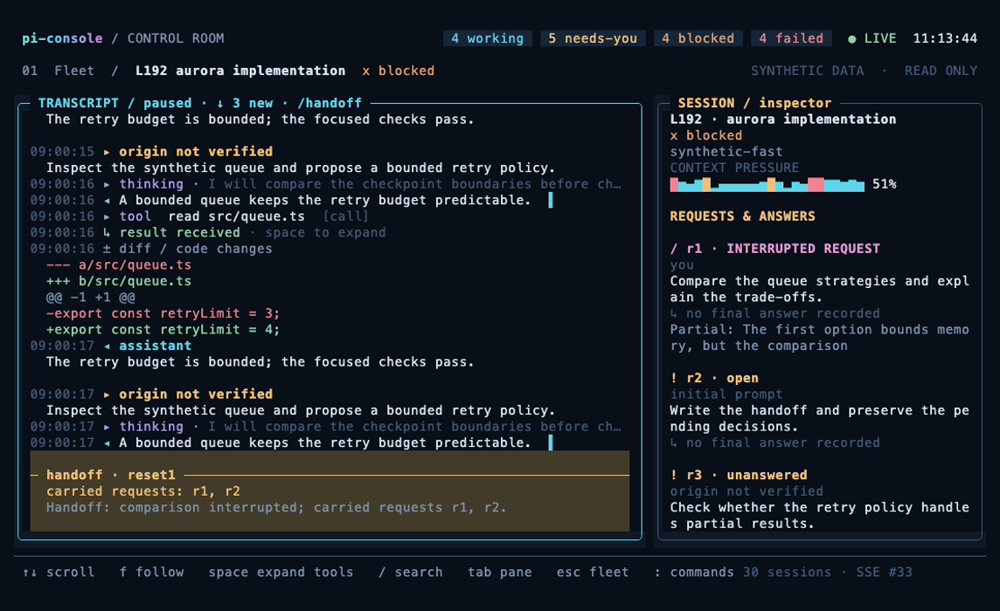
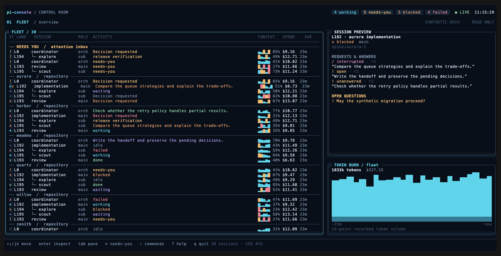
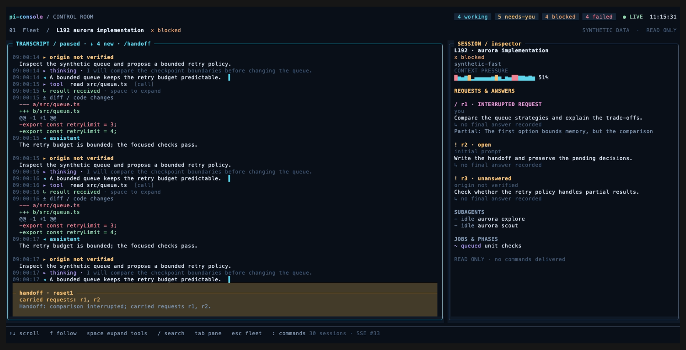
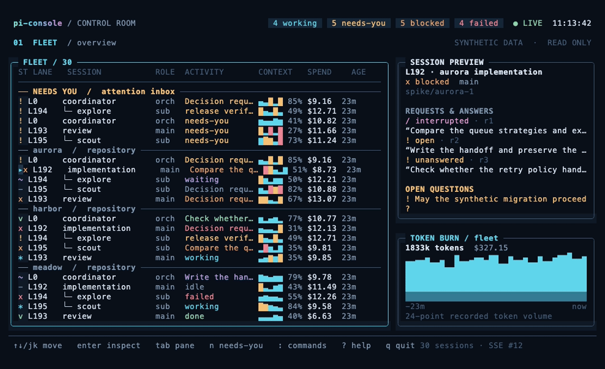

# M0 · Bubble Tea candidate

A read-only **control room** built with Bubble Tea v2, Lip Gloss v2 and Bubbles v2. The mock daemon remains the source of truth; no fixture values are baked into the rendered fleet. Midnight slate, cyan focus borders, amber attention, a restrained text ramp, block sparklines and a fleet token chart give it a compact operational feel.

## Screens

### Fleet · 120 × 36


### Session · 120 × 36



### Fleet · 200 × 50



### Session · 200 × 50



### Navigation, palette and streaming



The GIF is **8.12 s, approximately 2.9 MB**. PNGs and the GIF contain synthetic data only.

## Run

From the repository root, with Go 1.26 and Node 26:

```sh
cd spikes/tui-bubbletea
~/.pi/agent/bin/pi-phase run --kind build --policy fast --label m0-tui-bubbletea --timeout 300 -- go build -o pi-console .
cd ../..
node spikes/mock-daemon/server.ts
# In another terminal, still at the repository root:
spikes/tui-bubbletea/pi-console
```

The daemon creates `.pi-console-dev/token`. The client reads that file, sends bearer authentication on HTTP and SSE, and accepts loopback HTTP daemon URLs only. Flags: `--url`, `--token-file`, `--colors auto|16|256|truecolor`, `--detail`, `--duration`. Explicit color profiles are applied to the renderer; auto detects the terminal, including `COLORTERM`. No Go runtime or Node runtime is needed for the compiled client; Node is needed only for this mock daemon.

### Interaction

| Key | Result |
|---|---|
| `j/k`, arrows | Select a fleet row; scroll the focused detail pane |
| Enter / Esc | Open session / return to fleet |
| Tab | Switch pane focus; focused border turns cyan |
| Mouse | Click a fleet row; wheel scrolls the pane under the pointer |
| `n` in fleet | Toggle needs-you filter |
| Space / Enter in detail | Expand/collapse thinking and tool payloads |
| `g/G`, Home/End | Oldest retained entry / follow tail |
| `f` | Resume follow; clear the new-entry counter |
| `/`, then `n` | Search retained transcript text; next match |
| `:` / Ctrl+P | Fuzzy command/session palette |
| `?` | Help overlay |
| `q` / Ctrl+C | Quit UI; never abort an agent |

The palette includes session navigation, needs-you filtering, Midnight/Contrast theme switching and quit. Text input accepts bracketed paste. Wide layouts allocate 65% to the main pane; both requested terminal sizes are captured and model-tested. Below 100 columns the rail is hidden rather than stacked; below 60 × 18 a resize message replaces the UI.

## Implementation and fidelity

- Fleet: needs-you inbox first, repository groups, parent/child tree indentation, role, activity, context history, sampled spend and recorded age. Selection is keyed by session identity, not a moving array index. Updated rows fade over 1.2 s.
- Preview: request status, final answers when supplied, open questions. Chart aggregates the fixture's 24 token samples across all sessions.
- Detail: distinct origin-labelled user blocks, coalesced assistant deltas, globally expandable thinking/tools, result-received status, colored raw diffs and full-width reset dividers with carried request IDs. The interrupted request is independently visible in the rail.
- Rail: request/answer state, interim answers, subagents and jobs. At 120 × 36, Tab then scrolling reveals the lower sections.
- HTTP transcript history is merged with concurrent SSE deltas by cursor. Resume uses `Last-Event-ID`; disconnects show retry state, with a one-second reconnect delay. A rejected restart cursor falls back to a fresh snapshot.
- The network reader updates a mutex-protected read model. The UI samples at 20 Hz, not once per token. Only an 80-entry render window is formatted. Per-session retention is bounded at 5,000 entries, dropping the oldest 1,000 in chunks. A paused cursor does not drift as new entries arrive.

### Deliberate limits / missing items

This is a spike, not a finished transcript browser. Disclosure is global, not per block; search scans retained text, not daemon history; there is no per-match count, rich markdown, selection/copy UI or clickable job/subagent drilldown. A paused anchor eventually ages out under sustained stress. The right-pane wheel scroll is useful in detail; fleet preview is fixed. Narrow-screen rail stacking is not implemented.

The API provides raw tool call/result text, but not structured arguments, success/failure or a trustworthy request link on each user transcript entry. Consequently tools show an argument summary and **“result received”**, not invented success; unmatched transcript requests say **“origin not verified”** even when a nearby request has a known origin. Fixture timestamps are recorded, so fleet age is `updatedAt − startedAt`, not wall-clock uptime. Spend is the sum of supplied sample costs, not an independently authoritative billing total. The chart labels sample positions as minutes, matching the fixture cadence, rather than reconstructing irregular timestamp buckets.

## Measurements

Measured on macOS arm64, Apple M4 Pro, shared/busy host; Go 1.26.0, Node 26.8.1, VHS 0.11.0. These are local comparison numbers, not CI performance assertions.

| Metric | Result / method |
|---|---|
| Stress | 5,000 appended entries/s, live s2 detail, 120 × 36 PTY, 20 one-second `ps` samples |
| TUI CPU | **17.08% mean, 19.2% peak**; approximately 3.63 CPU-seconds by sample 20 |
| TUI RSS | **28.52 MiB mean, 28.91 MiB peak**; sample 1: 27.03 MiB |
| Rendering | 20 Hz read-model sampling; VHS stress recording at 5 fps |
| Input latency | Qualitatively immediate in the normal-rate navigation recording; no numeric or stress-input latency measurement |
| Build | **1.59 s wall**, 0.57 s user, 0.52 s system; warm dependencies/cache, changed-source build via `/usr/bin/time -p go build` |
| Startup | UI visible by the tape's **1 s post-launch wait**, including the demo helper's 0.5 s daemon wait; upper bound, not an isolated cold-process benchmark |
| Go LOC | **1,520 application + 283 tests = 1,803** physical lines, including blanks/comments |
| Harness LOC | 66 physical lines: measurement JS + check/demo shell scripts; tapes excluded |
| Dependencies | **5 direct, 23 indirect** modules in `go list -m all`; standard-library HTTP/SSE |
| Distribution | **11,737,474 bytes** (11.19 MiB), unstripped native executable; per-OS/architecture build; no dynamic application runtime |

Reproduce the stress sample and an untracked 20 s stress recording:

```sh
node spikes/tui-bubbletea/measure.mjs
```

This starts its own daemon on port 47872, uses VHS for a real PTY, samples only the TUI PID, and stops its daemon afterward. Raw samples and stress media go under `.ai-work/tui-bubbletea/`. The stress frames inspected showed intact panel borders and no obvious tearing; this is not a frame-perfect flicker analysis. At 5,000/s the following transcript necessarily replaces whole blocks too quickly to read. Pausing makes inspection practical, within the retention limit.

## Media reproduction

```sh
vhs docs/spikes/media/tui-bubbletea.tape
```

The main tape starts/stops its own mock through `demo.sh` on port 47871, captures the small screens and GIF, then invokes the wide companion tape hidden from the GIF. `tui-bubbletea-wide.tape` can run independently. Menlo is used on this macOS host; for another platform choose an installed monospace font and adjust pixel dimensions to retain the intended cell grid. The helper records the emulator's measured size before setting the PTY grid; verified grids are 36 × 120 and 50 × 200. Escape actions include a short separation from following input to avoid terminal Alt-key ambiguity. No credentials are typed into the recording.

## Checks

Passed:

```sh
# In spikes/tui-bubbletea:
~/.pi/agent/bin/pi-phase run --kind test --policy direct --label m0-tui-bubbletea --timeout 300 -- go test ./...
# From the repository root:
~/.pi/agent/bin/pi-phase run --kind test --policy direct --label m0-tui-bubbletea --timeout 300 -- npm test
```

The Go tests cover both terminal sizes, navigation, paused-tail counters, disclosure, provenance, reset carry-over, fuzzy selection, paste, mouse selection, ANSI sanitization, bounded retention, authenticated SSE, history merging, resume and projection upserts. The repository's **9 fixture/mock-daemon tests**, including HTTP/SSE integration and stress-rate behavior, passed.

The CI-equivalent combined gate was attempted:

```sh
~/.pi/agent/bin/pi-phase run --kind test --policy direct --label m0-tui-bubbletea --timeout 300 -- sh spikes/tui-bubbletea/check.sh
```

Within that gate, **gofmt, go vet, go test -race, JS syntax and shell syntax passed**. It then failed at the existing repository `npm run check`: `ERR_UNSUPPORTED_TYPESCRIPT_SYNTAX`, “TypeScript parameter property is not supported in strip-only mode”, on `constructor(readonly query: All)`. No shared file was modified to work around it. The subsequent gate phases did not run; the independent `npm test` run above passed. `git diff --check` also passed independently. Thus **the full Tier 1 gate is not green**, despite the candidate's own checks passing; this is not claimed PR-ready. No CI workflow/configuration exists in this checkout to reproduce beyond those native commands.

## Code Health

One score pass, no spike refactoring loop. All files are new (before score: not applicable).

| File under `spikes/tui-bubbletea/` | Before | After |
|---|---:|---:|
| main.go | — | 10.00 |
| data.go | — | 9.68 |
| client.go | — | 8.81 |
| model.go | — | 9.66 |
| fleet.go | — | 7.42 |
| detail.go | — | 8.90 |
| input.go | — | 8.20 |
| theme.go | — | 8.81 |
| overlay.go | — | 10.00 |
| model_test.go | — | 9.09 |
| client_test.go | — | 8.81 |
| measure.mjs | — | 10.00 |

The pre-commit Code Health safeguard checked 12 eligible source files and returned **failed / issues-found** (complexity, nesting and argument-shape findings); this is reported, not waived as a passing gate. The below-9.5 files are explicit spike exceptions: view composition, input branching, network loops and broad scenario tests need decomposition before productization. No claim that these meet the normal product-code threshold. Shell scripts, module metadata, Markdown and tapes are not scored as supported application source.

## Assessment

**Visual quality: 8/10.** Dense and consistent, with an immediately readable attention inbox, restrained semantic color, crisp focus outlines and a compelling wide-screen layout. The full-width handoff marker and interrupted-request rail make provenance visible. Small-screen text truncation and the large recorded chart need more information design; neither rich markdown nor fine-grained tool cards is finished.

**UX quality: 8/10.** Stable keyed selection, fast palette navigation, anchored pause/follow, keyboard/mouse focus and bounded streaming behave predictably. The stack makes a small executable with good terminal cleanup and no browser dependency at runtime. What fought me: cell-accurate clipping, manual virtualization, escape timing in terminal automation, font metrics in VHS, and overlay/paste event routing. Per-block disclosure, better rail affordances, narrow-screen stacking and safe long-history navigation remain product work.

**Open questions:** should structured tool outcomes and transcript-to-request links be added to the API, and what retention/backfill policy should the real client expose? The repository TypeScript check also needs an owner outside this spike.
