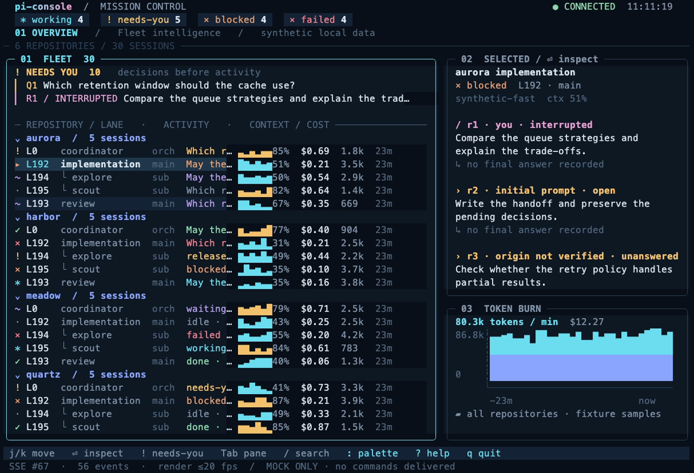
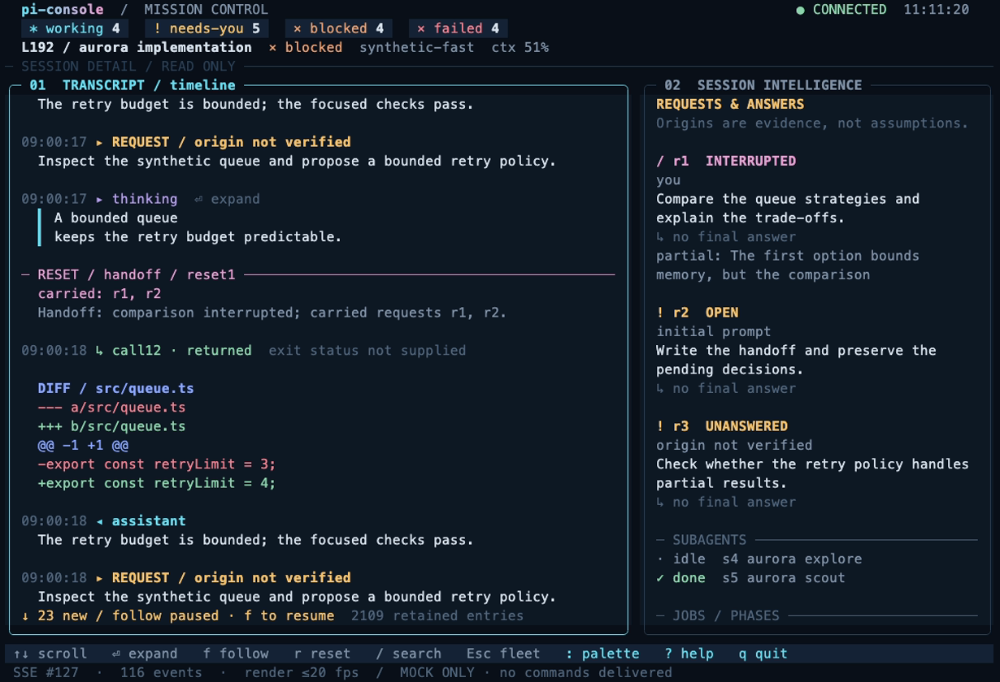
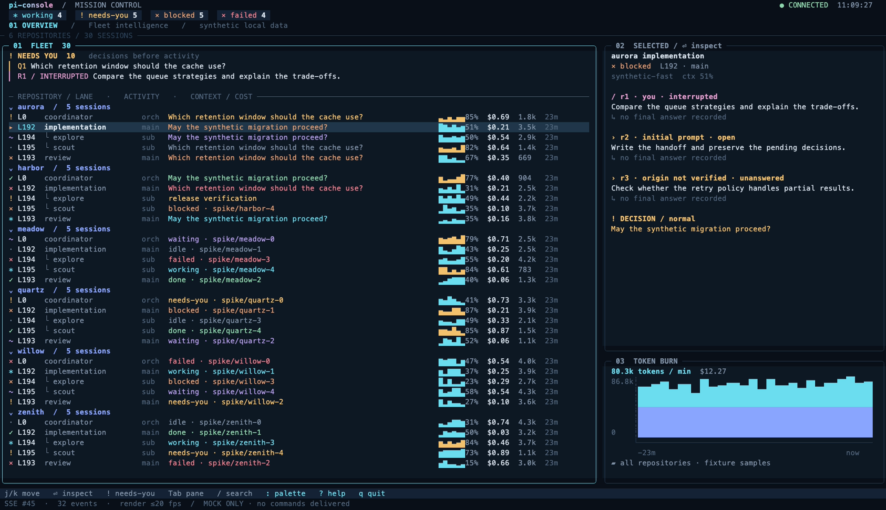
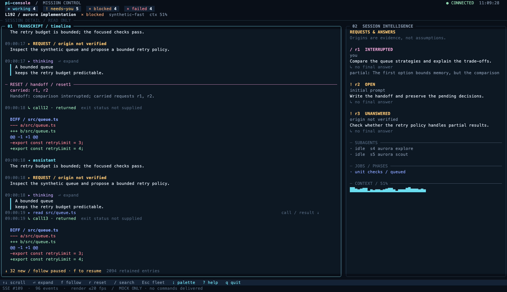
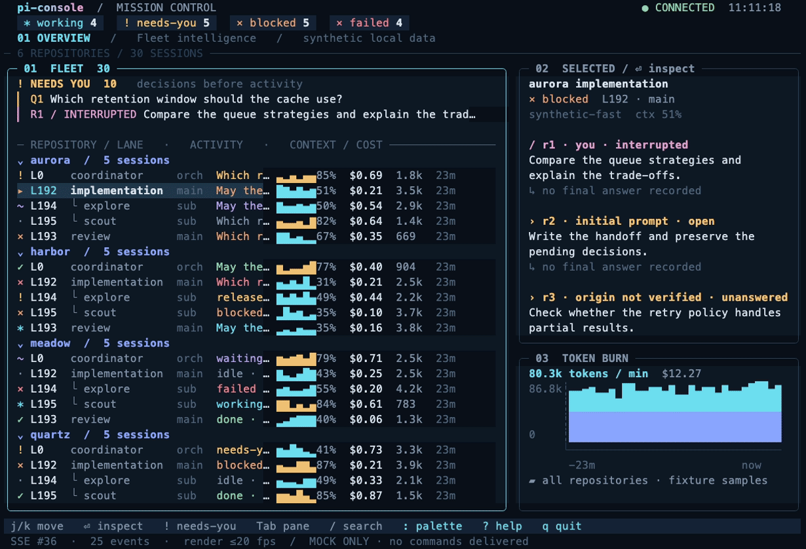

# M0 TUI candidate: pi-tui

A read-only, keyboard-first mission control client using **@earendil-works/pi-tui 0.85.1** and Node 26. No daemon, fixture, API, or root package changes.

## Run

From the repository root:

```sh
npm --prefix spikes/tui-pitui ci --ignore-scripts --workspaces=false
node spikes/mock-daemon/server.ts --port 4777 --rate 30
# In another terminal:
node spikes/tui-pitui/main.ts
```

The client reads the bearer token from `.pi-console-dev/token`. Options:

```sh
node spikes/tui-pitui/main.ts --url http://127.0.0.1:4777 \
  --token-file .pi-console-dev/token --colors truecolor
```

`--colors 16|256|truecolor` overrides detection (`COLORTERM`, then `TERM`). No FFI, compilation, native addon, or experimental runtime flag is needed. `--duration N` exits after N seconds for measurement. The client refuses non-loopback/non-HTTP URLs. Terminal escape sequences in daemon text are stripped.

## What was built

- **Fleet:** gradient wordmark, clock, connection indicator, coloured count pills; amber attention section; repository groups and parent/child session trees; status colours, activity, context-pressure block sparklines, sampled cost/tokens, age; selected-session requests/answers/questions; fleet token-burn block chart. Status updates briefly raise the row background (a 350 ms highlight, not a smooth alpha fade).
- **Detail:** streaming transcript entries, distinct request/assistant/thinking/tool styles, expandable thinking/tool payloads, coloured diffs, full-width handoff/reset divider with carried requests, interrupted-request badge, requests/answers/subagents/jobs/context side rail. Follow-tail pauses on scrolling, preserves its anchor while retained, counts new entries, and resumes with `f`.
- **Both:** focused pane borders, mouse selection/double-click/wheel, resize reflow, searchable transcript, fuzzy command/session palette, help, footer hints, Midnight/Contrast theme, SSE reconnect using Last-Event-ID.
- Rendering is capped at 20 fps, independently of SSE ingest. Tail formatting considers only the last 140 entries. Transcript retention is approximately 5,000 entries per session (amortized trimming permits up to 5,500); cached formatting is also bounded.

### Keys

| Key | Action |
| --- | --- |
| `j/k`, arrows | Move session / scroll transcript; scroll rail when focused |
| Enter / Space | Inspect session; expand last visible collapsible event |
| Tab / Shift+Tab | Switch focused pane |
| Mouse | Select row; double-click opens; click event expands; wheel scrolls |
| `f`, `G` | Follow live tail |
| `g`, `r` | Oldest retained entry / latest reset boundary |
| `/` | Filter transcript text; Enter keeps, Esc cancels |
| `!` | Toggle needs-you sessions |
| Ctrl+P / `:` | Fuzzy actions/session palette |
| `t`, `?` | Toggle contrast / show help |
| Esc / `1` | Fleet; Esc first clears an active search |
| `q`, Ctrl+C | Quit UI; never stop agents |

## Captures

### 120 × 36





### 200 × 50





### Navigation, palette, streaming



GIF: **8.24 s, 4,245,369 bytes**, verified with ffprobe. Screenshots show the real client against the mock API, not a static fixture renderer. Recorded terminal sizes were checked with `stty size`: `36 120` and `50 200`.

Recreate all four PNGs and the GIF:

```sh
bash spikes/tui-pitui/capture.sh
```

Primary [VHS tape](media/tui-pitui.tape) creates the narrow captures/GIF; `spikes/tui-pitui/wide.tape` creates the wide PNGs. **Deviation:** VHS dimensions are global, so the capture script serializes two tapes rather than changing dimensions inside one tape. Each tape starts and cleans up its own daemon. Fonts affect pixel-to-cell calibration; these settings use Menlo. The visible demo uses 30 entries/s so navigation is legible.

## Measurements

Measured on a shared, busy macOS machine; these are observations, not cross-stack benchmark guarantees.

| Metric | Result |
| --- | --- |
| Stress workload | Mock daemon `rate: 5000` (same option as CLI `--rate 5000`), 20 one-second samples, actual TUI process in an expect PTY, 120 × 36 |
| TUI CPU mean / peak | **19.885% / 41.9%** (`ps %cpu`; one core = 100%) |
| TUI RSS mean / peak | **244.61 / 283.16 MiB** |
| Startup to connected first output | **557 ms**, including expect/PTY/Node startup; daemon already running |
| Build/syntax/whitespace check | **409 ms** internal elapsed; no emitted build artifact |
| Hand-written application TS | **853 lines** across 7 files |
| All hand-written TS | **1,161 lines**, including tests/check/measurement; another 30 shell lines |
| Production dependencies | **1 direct, 2 transitive**; 0 dev dependencies |
| Distribution | npm + Node >=26, source TS shipped with lockfile; not a single binary |
| Runtime flags | None required; Node strips erasable TypeScript directly |
| Input latency | Qualitative: scroll/follow/palette/theme remained usable at 5k/s; no millisecond latency measurement |

The stress runner navigates to the transcript, pauses/resumes follow, opens the palette, changes theme and opens/dismisses help during the 20-second window. CPU peaks coincide with leaving the bounded tail view to format retained history. Raw samples remain ignored under `.ai-work/pitui-stress-beavUy/metrics.json`.

A separate short 5k/s VHS recording was inspected through a one-frame-per-second contact sheet: the new-entry counter advances, follow resumes, and the palette/theme take effect. No gross blank-screen flicker or torn pane borders appeared in those sampled frames; this is not proof of frame-perfect rendering. At 5k/s the text itself moves too quickly to read without pausing. That recording stays ignored under `.ai-work/pitui-media/`.

## Verification

All build/test commands were run through pi-phase:

```sh
# PASS: 9 headless smoke tests, including actual TuiAltScreen output and resize.
~/.pi/agent/bin/pi-phase run --kind test --policy direct --label m0-tui-pitui --timeout 300 -- node --test spikes/tui-pitui/smoke.test.ts

# PASS: authenticated live mock snapshot/history/SSE/reconnect at 5k/s (Tier 2).
~/.pi/agent/bin/pi-phase run --kind test --policy direct --label m0-tui-pitui-live --timeout 300 -- node --test spikes/tui-pitui/integration.test.ts

# PASS: 20-second CPU/RSS measurement and clean UI exit.
~/.pi/agent/bin/pi-phase run --kind test --policy direct --label m0-tui-pitui-stress --timeout 300 -- node spikes/tui-pitui/stress.ts

# PASS: candidate syntax, JSON and whitespace; not a static type-check.
~/.pi/agent/bin/pi-phase run --kind build --policy fast --label m0-tui-pitui-check --timeout 300 -- npm --prefix spikes/tui-pitui run check

# PASS: 9 existing fixture/mock-daemon tests, then 9 candidate smoke tests.
~/.pi/agent/bin/pi-phase run --kind test --policy direct --label m0-tui-pitui-tests --timeout 300 -- sh -c 'npm test && node --test spikes/tui-pitui/smoke.test.ts'
```

The requested **Tier 1 whole-repository gate was attempted but failed**, so this is not a claim of repository-wide PR readiness:

```sh
~/.pi/agent/bin/pi-phase run --kind build --policy fast --label m0-tui-pitui-tier1 --timeout 300 -- sh -c 'npm run check && npm --prefix spikes/tui-pitui run check && npm test && node --test spikes/tui-pitui/smoke.test.ts'
```

First error: pre-existing `spikes/arc-ts/client/generated/All.ts:16`, `constructor(readonly query: All)`, `ERR_UNSUPPORTED_TYPESCRIPT_SYNTAX`. Root `check.ts` walks every spike but uses Node's strip-only mode, which rejects parameter properties. Verified that the offending code exists in the base commit. Dependent phases of that gate did not run; isolated candidate checks and the root package's test command ran separately and passed. Older Arc/SQLite spike builds/tests were not run after this blocker. No CI workflow, gate script, or Release configuration exists in this checkout. No unrelated source was changed.

The first measurement attempt used macOS `script` with piped stdin and failed (`tcgetattr/ioctl: Operation not supported on socket`); the final passing runner uses the already-installed system `expect` instead.

## Code Health

CodeScene `code_health_review` was run on the app controller; `code_health_score` was run once on every hand-written TS file. All files are new, so there is no pre-existing score to compare. Per the spike brief, scores are reported without a refactoring loop.

| File in `spikes/tui-pitui/` | Before | After |
| --- | --- | --- |
| app.ts | new | 7.69 |
| client.ts | new | 10.00 |
| model.ts | new | 9.84 |
| paint.ts | new | 9.38 |
| fleet.ts | new | 9.68 |
| transcript.ts | new | 8.64 |
| main.ts | new | 10.00 |
| smoke.test.ts | new | 10.00 |
| integration.test.ts | new | 10.00 |
| check.ts | new | unavailable |
| stress.ts | new | unavailable |

Uplift follow-ups: `app.ts` (event dispatch/overlay state complexity), `paint.ts` (primitive/style arguments), `transcript.ts` (heterogeneous entry formatting). They miss the 9.5 target; no architecture-wide cleanup was attempted for the bake-off. CodeScene could not score the two top-level scripts. Installation verification confirmed authentication and CLI/API connectivity; it reported missing repository agent instructions. JSON, tapes, media and shell helpers are outside the TypeScript score table.

The staged `pre_commit_code_health_safeguard` checked all 11 TS files and **failed**, flagging introduced complexity/argument smells in `app.ts`, `transcript.ts`, `fleet.ts`, `model.ts`, and `paint.ts`. This is an explicit spike exception, not a passing Code Health gate. `git diff --cached --check` and `bash -n spikes/tui-pitui/record.sh spikes/tui-pitui/capture.sh` passed.

## What felt great / what fought back

**Great:** the existing pi-tui alternate-screen renderer, ANSI-aware widths/composition, fuzzy filtering, input decoding, mouse events and terminal lifecycle were enough to ship without a framework adapter. Startup is fast and the dependency surface is tiny. The provenance rail and magenta handoff line make uncertainty/interruption hard to miss. The wide layout reads like a real control surface.

**Friction:** this is a low-level component library, not a full dashboard kit. Borders, tables, chart, layout, hit-testing, focus and transcript viewport/caches are hand-written. A better structured event navigator would reduce application complexity. VHS font/cell calibration and macOS PTY measurement needed care.

### Honest limitations / missing polish

- The mock transcript has no request-id/origin association. Transcript user rows therefore say **origin not verified**; the rail uses the real request-origin evidence and shows **you / initial prompt / origin not verified**. No guessed provenance.
- Tool results lack exit/success status and structured arguments. The UI shows the supplied call/argument summary, **returned**, and **exit status not supplied**, never inventing a successful exit.
- Burn/cost/context charts show API-supplied historical samples, not inferred token accounting from text events. Assistant deltas are styled incremental lines rather than a coalesced Markdown document.
- Thinking, call and result payloads expand independently. Keyboard Enter targets the last visible collapsible entry; mouse offers precise entry targeting. There is no dedicated keyboard event-selection cursor.
- No older-history fetch beyond the bounded initial five pages and retained live window. A paused anchor can expire under sustained 5k/s load. Search covers retained transcript text, not all daemon history.
- Panes stay split until the minimum 76 × 20 fallback; no mobile-style stacked layout. Small rails require Tab + scrolling to see jobs/subagents. Rows cannot display all columns fully at the minimum width.
- No interventions are sent: intentionally read-only; the mock daemon is never treated as an agent-control channel.

**Self-scores:** visual quality **8/10** (coherent colour hierarchy, dense fleet, readable reset/diff treatment, but compact rows and hand-built chart lack a top-tier dashboard's finishing touches). UX quality **7.5/10** (fast navigation/palette, sensible focus/follow/search, honest provenance; keyboard event targeting and bounded scrollback are the main compromises).

**Open questions:** none blocking the candidate comparison. Repository-wide gate repair and the three Code Health uplifts are separate follow-ups before production adoption.
