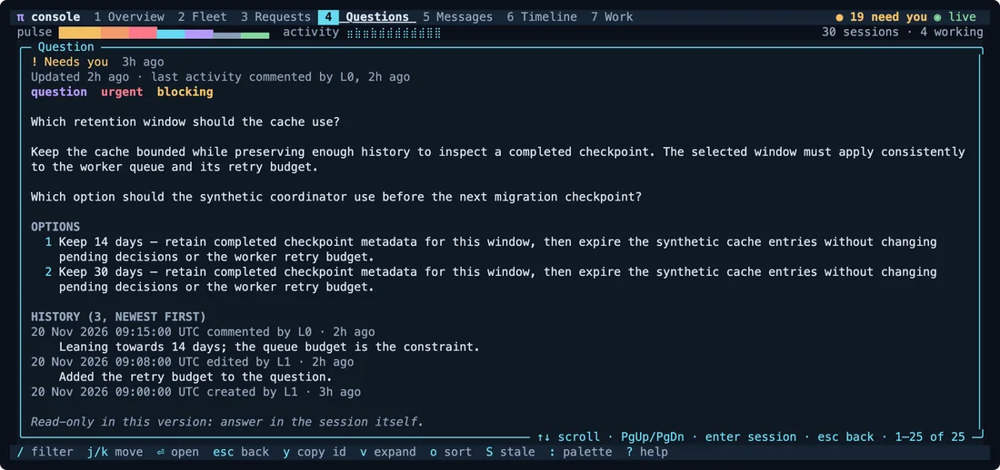

# TUI (OpenTUI)

Status: M1 implementation, read-only by default, with request-only memory review. Decision: [ADR-0003](adr/0003-tui-stack-bake-off.md). Same API and the same view models as the web console ([information architecture](information-architecture.md)); the TUI holds no attention, pairing or status logic.

## Run it

```sh
npm ci
npm start                                   # mock daemon on 127.0.0.1:4777 (token in .pi-console-dev/token)
export PI_CONSOLE_DATA_DIR="$PWD/.pi-console-dev"   # the TUI's default token path is ~/.pi-console/token, not the mock daemon's
npm start -w @pi-console/tui                # the TUI, in another terminal
node packages/cli/bin/pi-console.mjs tui    # the same through the CLI (adds --experimental-ffi in a child process)
node packages/cli/bin/pi-console.mjs tui --data-dir "$PWD/.pi-console-dev" --url http://127.0.0.1:5888  # explicit daemon
```

Needs Node 26 (the engine floor) because OpenTUI loads its native core through `node:ffi`. The daemon URL resolves in order: CLI `--url`, `PI_CONSOLE_URL`, `port` in `<data-dir>/config.json`, then `http://127.0.0.1:4777`. Configured ports use `127.0.0.1`; explicit URLs must still be loopback HTTP origins. Missing or malformed configuration silently uses the default port. The data directory resolves from CLI `--data-dir`, then `PI_CONSOLE_DATA_DIR`, then the daemon's default `~/.pi-console`. Credentials resolve from `PI_CONSOLE_TOKEN`, then `PI_CONSOLE_TOKEN_FILE`, then `<data-dir>/token`, using the same directory as the configuration. A token file readable by anyone but its owner is refused. When offline, the reconnect banner shows the URL being tried. A daemon started with a one-off `--port` needs a matching TUI `--url` unless that port is also saved in `config.json`. `PI_CONSOLE_REDUCED_MOTION=1` turns spinners and pulses off; `PI_CONSOLE_THEME=midnight|contrast|mono` picks the theme (`PI_CONSOLE_HIGH_CONTRAST=1` still means contrast, and `mono` is a grey theme with meaning carried by glyphs and bold; Settings shows a preview). A non-empty `NO_COLOR` overrides all of these (see [no-color.org](https://no-color.org)): the TUI asks for no foreground or background colour, never paints a background so the terminal keeps its own, and carries status by glyphs, bold and inverse video (selection, focus badges); the focused panel gets a double border. An empty `NO_COLOR` is ignored. OpenTUI still writes its default white on blank cells nothing was drawn on, which shows nothing; colour depth follows `COLORTERM`/`TERM`.

## Views

At narrow widths, the header keeps the needs-you count visible by dropping the connection pill and inactive section shortcuts first. Fleet omits cost and age when they cannot fit and shows `+cost age hidden — widen terminal`; those columns return when there is room. Text clipping and wrapping use terminal-cell widths, keeping CJK characters, combining marks and joined emoji intact. The TUI measures with OpenTUI's active `widthMethod`: grapheme widths when the terminal supports mode 2027, `wcwidth` otherwise (including headless rendering). Joined emoji can take more than two cells in the fallback mode. Shared format helpers accept a client measurement function; their default grapheme budget, used by the web, is unchanged.

Number keys jump, clicks work on tabs and rows. Everything except explicit memory-review requests is read-only; `q` only leaves the TUI.

| Key | View | What it shows |
|---|---|---|
| `1` | Overview | "Needs you" cards from `/needs-you` plus a fleet summary: status bars, context sparkline, tokens, cost |
| `2` | Fleet | Repositories, then sessions by lane with status glyph, context bar, age, cost; `/` filters, `space` folds a group, `Enter` opens a session |
| (Enter) | Session | Transcript with tool calls, diffs and reset markers; `f` follows the tail, `/` searches, `m` opens the full-width Memory view at any width (see [Memory review](#memory-review)), `Enter` opens the entry at the top of the view in full (wrapped, scrollable with `↑`/`↓`, `PgUp`/`PgDn`, `Home`/`End`; `Esc` closes it and returns to the same place; shortened previews end with "… N more lines"; with a search active it opens scrolled to the first match, highlighted); right rail cycles requests, questions, jobs, resets (`Tab`) |
| `3` | Requests | Requests with origin evidence, answer state and partial-answer flags; `[` / `]` step the state filter, `o` the origin filter and `S` the session filter (each wraps, and the header line shows what is on) |
| `4` | Questions | Open, blocking and urgent questions with options, links, last-updated and last-activity times and a text-labelled `stale` warning on open questions with no activity for the chosen number of days; `o` cycles the order (priority, last updated, last activity) and `S` the warning threshold (1, 7, 14, 30 days; default 7); a `Possibly moot` line when every linked GitHub item was observed closed or merged within the last hour (the expanded view lists the evidence per target); the expanded view lists the full history newest first (operation, actor, time, sanitized note); `v` expands the selected question at any width, with full text and wrapped options; arrows/PgUp/PgDn/Home/End scroll, `v` or Esc returns |
| `5` | Messages | Inter-agent messages with delivery state; `v` switches to the canonical lane communication graph, with session spawn relationships in a separate section; `t` shows a last-activity scrubber, `h`/`l` or left/right arrows move the cutoff, Esc hides it |
| `6` | Timeline | Per-session lanes with request, answer and message markers; `+`/`-` zoom, `h`/`l` pan, `t` scrubs |
| `7` | Work | Jobs (phases, ci, watchers) with state, exit code and owning session |
| `:` `Ctrl+P` | Palette | Commands, and `@` finds a session |
| `?` `,` | Help, Settings | The shared keymap; connection health, data counts and sources |

`Tab` / `Shift+Tab` (session panes) and `t` on the Timeline exist only in the TUI; the web console does not list or handle them. `y` copies the id of the selected row, or the session id inside a session.

Lists show `Loading…` until the first snapshot arrives and a "No … matches" line when a filter hides every row. If the graph read fails, the Messages graph shows `Could not load the graph` (noting when it is the last loaded graph) and `r` retries; a daemon without the `/graph` route shows the empty graph. Settings adds a `Daemon health` section from `/health` once it has been read.

Times are shown in the terminal's local zone (24-hour). A faint date rule opens each local day in the transcript and the panel title names the first visible day; `Enter` on an entry shows its full local date, time, UTC offset and zone name above the text. Question history shows the same absolute time beside the relative age.

Opening an available session from Questions or Messages shows its latest entries; it does not locate or highlight the originating question or message, because those sources carry no reliable transcript entry reference. Only a jump that has a valid transcript pointer (for example from Requests) opens at that entry.

The graph scrubber starts at the newest lane-edge activity and shows edges whose last activity is at or before the cutoff. Counts remain all-time; session spawn relationships are not filtered. At wide widths, selecting a lane edge shows known messages between its sessions in the Conversation panel's Recent list.

Help and Settings scroll with arrows or `j`/`k`, PgUp/PgDn and Home/End (or `g`/`G`), including on short terminals, and show the visible row range. Esc closes either overlay; `?` also closes Help.

Fleet, Requests, Questions, Messages and Work load older history when you reach the last loaded row; Timeline also loads older resets. If a history page fails, press `r` to retry, or try moving forward again at the end of the list.

"Needs you" also refreshes every 60 seconds while connected, even without new stream events. After a failed load, press `r` in Overview to retry.

Header: brand, tabs, a "N need you" pill and the live/offline link. Attention shows "checking…" before the first load and "attention unavailable" if it fails ("unavailable" at compact widths). Cached counts after a failed refresh are marked "stale" in the header and Overview; only a successful empty load shows a current "all clear". Footer: the keymap's hints for the current context (so a new binding appears here without TUI changes). While the stream is down a banner says the daemon is unreachable, when the visible data was last received and the last error (the as-of time gives way to the error on narrow terminals; the endpoint clips first); the client reconnects with capped backoff and resumes through `Last-Event-ID`. If the daemon refuses that sequence (HTTP 400, for example after its event store was reset), the client drops it, clears its mirrored state and reconnects at once for a fresh snapshot. A rejected token (HTTP 401) is reported as "Token rejected · check PI_CONSOLE_TOKEN or --data-dir" and retried only every 30 seconds, since the same token works again only if the daemon behind the port changes. Below 112 columns the tab labels collapse to numbers and side panels drop; the header also collapses tabs when its status text needs the room; transcript text is sanitised, so terminal escapes in a session cannot reach the screen.

Screenshots and a tour, captured from the real TUI on a pty against the mock daemon's synthetic fixture by `npm run media` ([docs/media/README.md](media/README.md)). `npm run media -w @pi-console/tui` still writes a full per-view SVG and plain-text capture into `docs/media/tui/` as scratch output (not committed).




Animated tour: [tui-tour.gif](media/tui-tour.gif).

## Structure

- `packages/tui/src/view/renderer.ts` is the **only** file that imports OpenTUI: primitives (Screen, Panel, Lines, Row, Column, Overlay, Clickable), hooks (`useKeys`, `useSize`, `useTick`, `useClipboard`), `launch` and a headless mount for specs. Views are written against it with plain `createElement` (no TSX, because Node strips types but does not compile JSX).
- `state/` pure UI reducer and key translation to the neutral names of the shared keymap; `store/` coalescing mirror of daemon state (at most about 20 renders a second); `api/` HTTP client, SSE parser and token resolution; `views/` one module per view; `shell/` header, footer, banner, overlays; `app.ts` wiring; `runtime.ts` connects client, store and renderer.
- View models, the keymap, the palette and settings come from `packages/viewmodels`, shared with the web UI; golden JSON snapshots there are what both clients are tested against.

## Memory review

With daemon review explicitly enabled and a compatible owning interactive pi provider (protocol v1), connect using the separate memory-control credential: `PI_CONSOLE_TOKEN_FILE=<data-dir>/memory-control-token` (or explicitly supply it through `PI_CONSOLE_TOKEN`). Default `<data-dir>/token` stays read-only; credentials still use owner-only file checks and are never printed.

In a session, use `Tab` / `Shift+Tab` to reach the **Memory** pane. Press `m` in a session transcript to open the full-width **Memory** view at any terminal width; `Tab` / `Shift+Tab` still reach the Memory pane, which is also drawn as a side rail at 112 columns or wider. The review keys work only while Memory is visible: in that overlay, or in the unobscured wide rail. `[` / `]` select a memory item (stepping past the loaded edge loads older items when more exist, and `r` retries a failed load); `c` requests **Confirm…**, `x` requests **Reject…** for the selected recorded, non-withheld proposal. These keys do nothing in other panes, other overlays, searches, a hidden narrow-screen pane or without a session. In the overlay the selected item is shown in full, wrapped to the terminal width, and scrolls with `↑`/`↓` (or `j`/`k`), `PgUp`/`PgDn` and `Home`/`End` (or `g`/`G`); choosing another item starts it at the top. `Esc` closes the view and returns to the transcript with its anchor, follow state and search unchanged. Outside the overlay, transcript movement, search, follow-tail and pane navigation are unchanged.

Finish each native human confirmation in the owning pi session. Progress is **Awaiting confirmation in pi**, then **Pi reported approval; awaiting producer ingestion**. Only producer ingestion updates canonical item status and counts; approval receipts cannot do so. Decline, conflict, unavailable and expiry before approval are non-applied outcomes. Unknown is not proof that nothing was applied: reported writes remain unverified until canonical ingestion is observed, never falsely expired. Transient receipt failures retry with backoff through the deadline plus ingestion grace, then canonical memory refreshes once. Request identity stays bound to its original session across navigation; reconnect never re-sends a POST, and exit cancels polling. Check pi before retrying an unknown/lost result.

The pane explains disabled, read-only, offline, unsupported and not-ready availability separately; old daemons/disconnections also fall back safely. Exact `/memory confirm <id>` and `/memory reject <id>` commands remain available. No private producer store is read by the TUI.

## Tests

- `npm test -w @pi-console/tui` (also part of `npm run gate`): reducer, keys, store, API and token specs; headless interaction specs run the full app in OpenTUI's in-memory renderer against the mock daemon (navigation, palette, filter, help, settings, timeline, graph, resize, reconnect banner, escape sanitising); parity specs check every golden row from the view-model package appears on screen.
- `npm run gate:integration -- --scope tui`: `src/tui.integration.ts` launches the real process on a pty (`script`) against the mock daemon, reads the screen through `@xterm/headless`, visits every view, opens the palette and a session, and quits with status 0.
- Linux: `sh scripts/tui-linux.sh` does a fresh `npm ci` on `node:26-slim` in Docker and runs that spec. Evidence of the first run: Linux arm64, Node 26, 4 of 4 passing (see the P4 report). Linux x64 has the same pinned native package in the lockfile but was not run.

## Pinned versions and native provenance

| Package | Version | Note |
|---|---|---|
| `@opentui/core`, `@opentui/react` | 0.9.6 | exact pin, lockfile integrity |
| `react` | 19.3.1 | |
| `@xterm/headless` | 6.0.0 | specs and media only |

The native core arrives as the platform package `@opentui/core-<os>-<cpu>` (darwin, linux, win32; arm64 and x64; glibc and musl on Linux), selected by `npm ci`, so the only network access is install time against the npm registry. Nothing is downloaded at runtime. See [security](security.md#native-code-in-the-tui-ffi).

## Fallback: Bubble Tea

The Go Bubble Tea implementation from the bake-off ([round 2](spikes/tui-bubbletea-r2.md)) stays untouched in `spikes/tui-bubbletea` as the fallback. Triggers: the Linux install or runtime spec fails and one diagnosed fix does not resolve it, or an unpatched native-dependency CVE in OpenTUI. Switching is an owner/orchestrator decision; the API, view models and keymap are client-neutral, so a Go client would reimplement only rendering.

## Known gaps

- No visual regression of the colour output; specs assert text, and the SVGs are for review.

## Session memory pane

The session view's side pane cycles through `memory` as its fifth tab (same keys as the other panes), and `m` opens the same content as a full-width, scrollable view with the selected item shown whole at any width; the side pane remains as the optional rail from 112 columns. It renders the same panel as the web: counts, the unresolved lower bound in plain words, items (a `[status]` badge, the text, then a smaller details line), the exact `/memory confirm <id>` text for proposed items and the handoff figures. The explicit `c` / `x` [memory-review keys](#memory-review) POST requests for native confirmation in pi when available; they do not write memory directly.
