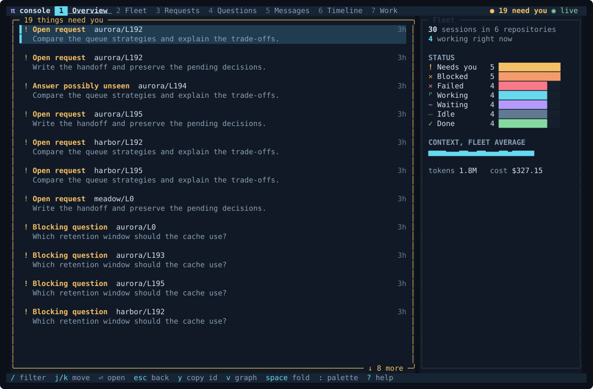
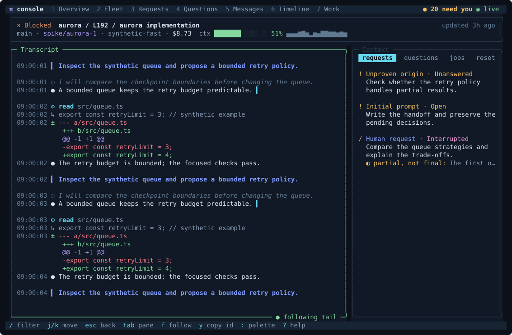

# TUI (OpenTUI)

Status: M1 implementation, read-only. Decision: [ADR-0003](adr/0003-tui-stack-bake-off.md). Same API and the same view models as the web console ([information architecture](information-architecture.md)); the TUI holds no attention, pairing or status logic.

## Run it

```sh
npm ci
npm start                                   # mock daemon on 127.0.0.1:4777 (token in .pi-console-dev/token)
export PI_CONSOLE_DATA_DIR="$PWD/.pi-console-dev"   # the TUI's default token path is ~/.pi-console/token, not the mock daemon's
npm start -w @pi-console/tui                # the TUI, in another terminal
node packages/cli/bin/pi-console.mjs tui    # the same through the CLI (adds --experimental-ffi in a child process)
```

Needs Node 26 (the engine floor) because OpenTUI loads its native core through `node:ffi`. Connection settings, in order: `PI_CONSOLE_URL` (loopback HTTP only, default `http://127.0.0.1:4777`), `PI_CONSOLE_TOKEN`, `PI_CONSOLE_TOKEN_FILE`, `<PI_CONSOLE_DATA_DIR or ~/.pi-console>/token`. A token file readable by anyone but its owner is refused. `PI_CONSOLE_REDUCED_MOTION=1` turns spinners and pulses off; `PI_CONSOLE_THEME=midnight|contrast|mono` picks the theme (`PI_CONSOLE_HIGH_CONTRAST=1` still means contrast, and `NO_COLOR` means mono: greys only, with meaning carried by glyphs and bold; Settings shows a preview); colour depth follows `COLORTERM`/`TERM`.

## Views

Number keys jump, clicks work on tabs and rows. Everything is read-only; `q` only leaves the TUI.

| Key | View | What it shows |
|---|---|---|
| `1` | Overview | "Needs you" cards from `/needs-you` plus a fleet summary: status bars, context sparkline, tokens, cost |
| `2` | Fleet | Repositories, then sessions by lane with status glyph, context bar, age, cost; `/` filters, `space` folds a group, `Enter` opens a session |
| (Enter) | Session | Transcript with tool calls, diffs and reset markers; `f` follows the tail, `/` searches; right rail cycles requests, questions, jobs, resets (`Tab`) |
| `3` | Requests | Requests with origin evidence, answer state and partial-answer flags |
| `4` | Questions | Open, blocking and urgent questions with options |
| `5` | Messages | Inter-agent messages with delivery state; `v` switches to the communication graph |
| `6` | Timeline | Per-session lanes with request, answer and message markers; `+`/`-` zoom, `h`/`l` pan, `t` scrubs |
| `7` | Work | Jobs (phases, ci, watchers) with state, exit code and owning session |
| `:` `Ctrl+P` | Palette | Commands, and `@` finds a session |
| `?` `,` | Help, Settings | The shared keymap; connection health, data counts and sources |

Header: brand, tabs, a "N need you" pill and the live/offline link. Footer: the keymap's hints for the current context (so a new binding appears here without TUI changes). While the stream is down a banner shows the error and the sequence number it will resume from; the client reconnects with capped backoff and resumes through `Last-Event-ID`. Below 112 columns the tab labels collapse to numbers and side panels drop; transcript text is sanitised, so terminal escapes in a session cannot reach the screen.

Screenshots and a recording, all captured from the real TUI on a pty against the mock daemon (`npm run media -w @pi-console/tui` regenerates them; `.svg` has colour, `.txt` is the plain screen):

| | | |
|---|---|---|
| [Overview](media/tui/overview.svg) | [Fleet](media/tui/fleet.svg) | [Session](media/tui/session.svg) |
| [Requests](media/tui/requests.svg) | [Questions](media/tui/questions.svg) | [Messages](media/tui/messages.svg) |
| [Graph](media/tui/graph.svg) | [Timeline](media/tui/timeline.svg) | [Work](media/tui/work.svg) |
| [Palette](media/tui/palette.svg) | [Help](media/tui/help.svg) | [Settings](media/tui/settings.svg) |
| [Reconnect banner](media/tui/reconnecting.svg) | [Tour (asciicast, `asciinema play`)](media/tui/tour.cast) | [Tour in colour (asciicast, `asciinema play`)](media/tui/tour-colour.cast) |




## Structure

- `packages/tui/src/view/renderer.ts` is the **only** file that imports OpenTUI: primitives (Screen, Panel, Lines, Row, Column, Overlay, Clickable), hooks (`useKeys`, `useSize`, `useTick`, `useClipboard`), `launch` and a headless mount for specs. Views are written against it with plain `createElement` (no TSX, because Node strips types but does not compile JSX).
- `state/` pure UI reducer and key translation to the neutral names of the shared keymap; `store/` coalescing mirror of daemon state (at most about 20 renders a second); `api/` HTTP client, SSE parser and token resolution; `views/` one module per view; `shell/` header, footer, banner, overlays; `app.ts` wiring; `runtime.ts` connects client, store and renderer.
- View models, the keymap, the palette and settings come from `packages/viewmodels`, shared with the web UI; golden JSON snapshots there are what both clients are tested against.

## Tests

- `npm test -w @pi-console/tui` (also part of `npm run gate`): reducer, keys, store, API and token specs; headless interaction specs run the full app in OpenTUI's in-memory renderer against the mock daemon (navigation, palette, filter, help, settings, timeline, graph, resize, reconnect banner, escape sanitising); parity specs check every golden row from the view-model package appears on screen.
- `npm run gate:integration -- --scope tui`: `src/tui.integration.ts` launches the real process on a pty (`script`) against the mock daemon, reads the screen through `@xterm/headless`, visits every view, opens the palette and a session, and quits with status 0.
- Linux: `sh scripts/tui-linux.sh` does a fresh `npm ci` on `node:26-slim` in Docker and runs that spec. Evidence of the first run: Linux arm64, Node 26, 4 of 4 passing (see the P4 report). Linux x64 has the same pinned native package in the lockfile but was not run.

## Pinned versions and native provenance

| Package | Version | Note |
|---|---|---|
| `@opentui/core`, `@opentui/react` | 0.9.6 | exact pin, lockfile integrity |
| `react` | 19.3.1 | |
| `@xterm/headless` | 6.0.0 | specs and media only |

The native core arrives as the platform package `@opentui/core-<os>-<cpu>` (darwin, linux, win32; arm64 and x64; glibc and musl on Linux), selected by `npm ci`, so the only network access is install time against the npm registry. Nothing is downloaded at runtime. See [security](security.md#native-code-in-the-tui-ffi).

## Fallback: Bubble Tea

The Go Bubble Tea implementation from the bake-off ([round 2](spikes/tui-bubbletea-r2.md)) stays untouched in `spikes/tui-bubbletea` as the fallback. Triggers: the Linux install or runtime spec fails and one diagnosed fix does not resolve it, or an unpatched native-dependency CVE in OpenTUI. Switching is an owner/orchestrator decision; the API, view models and keymap are client-neutral, so a Go client would reimplement only rendering.

## Known gaps

- Help lists the whole keymap and is cut off on terminals shorter than about 45 rows.
- No visual regression of the colour output; specs assert text, and the SVGs are for review.

## Session memory pane

The session view's side pane cycles through `memory` as its fifth tab (same keys as the other panes). It renders the same panel as the web: counts, unresolved bound, items, the exact `/memory confirm <id>` text for proposed items and the handoff figures. No key writes anything.
