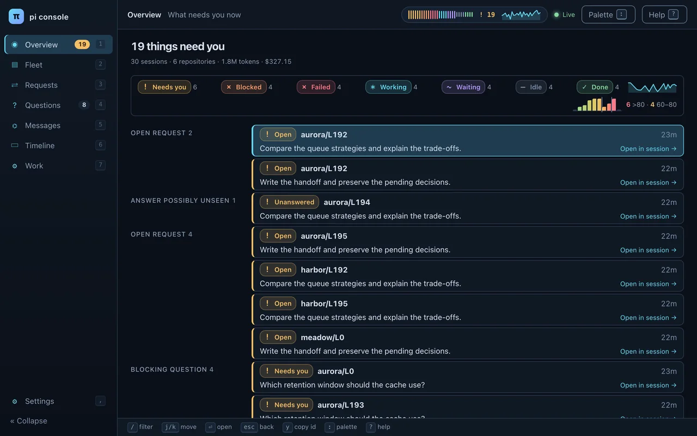
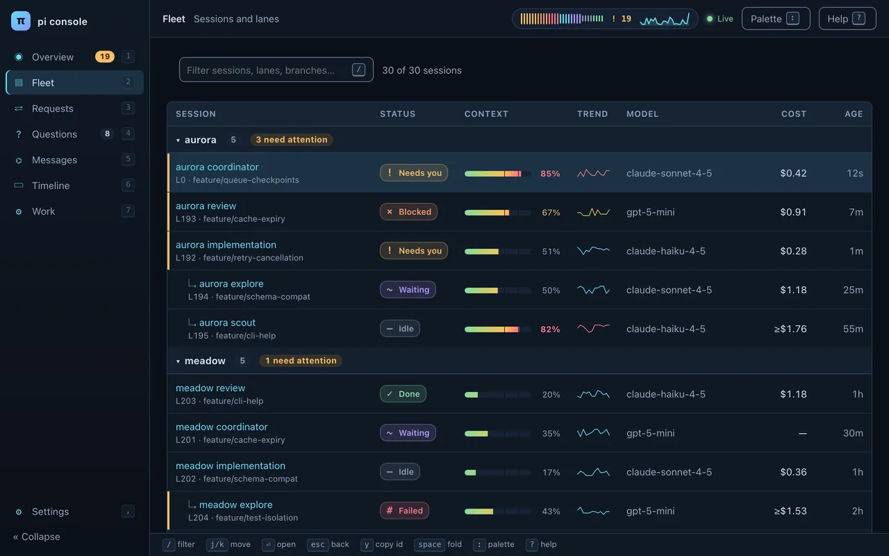
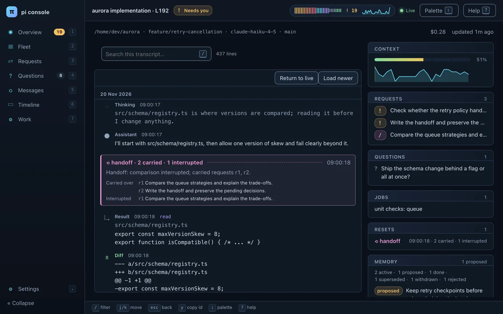
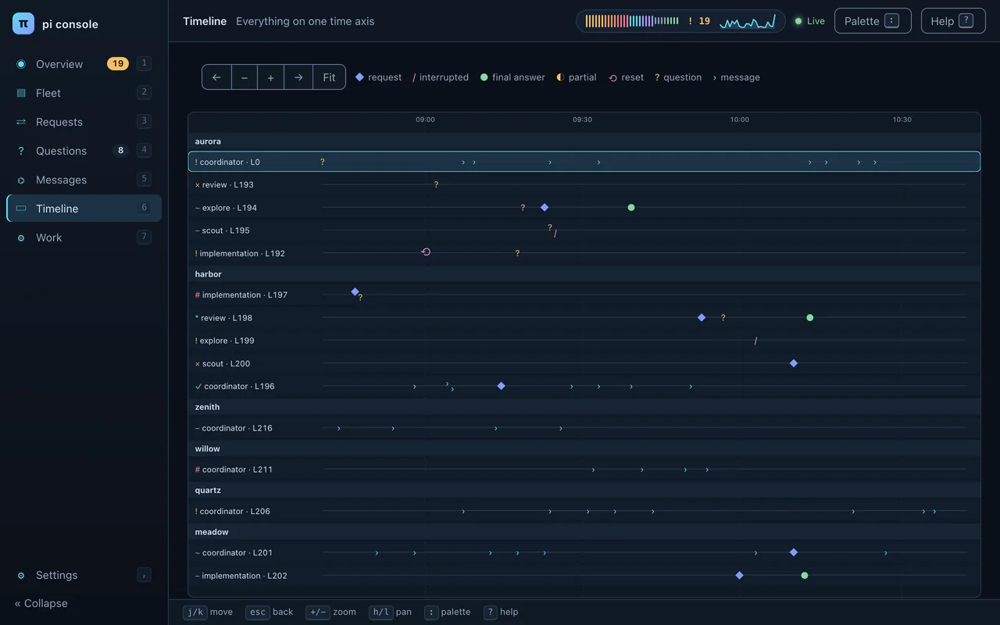
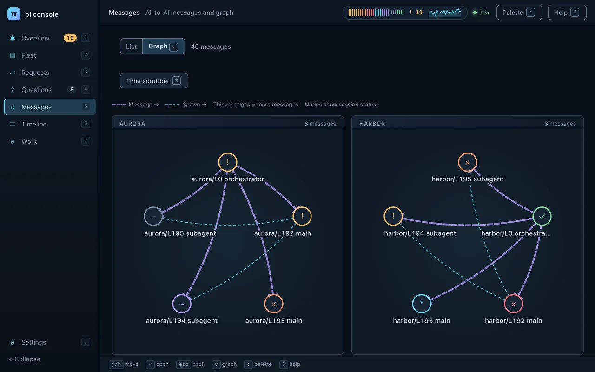
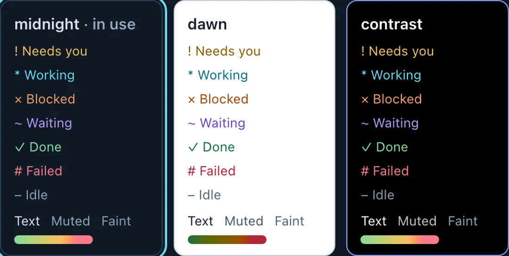
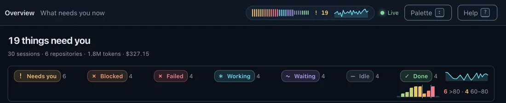
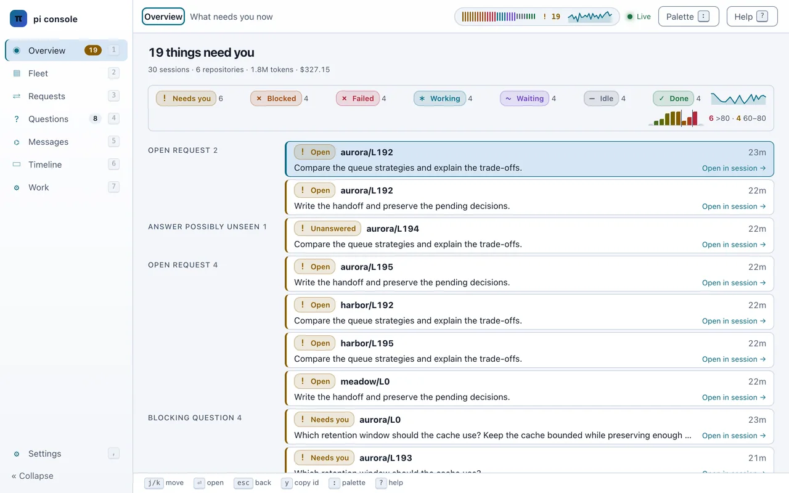

# Web UI

The web console is a React app with request-only memory review (`packages/web`) at parity with the TUI. Both render the same view models from `@pi-console/viewmodels` and use the same keymap, so a screen means the same thing in either.

## Run

```
npm run build -w @pi-console/web            # typecheck + vite build into packages/web/dist
npm run serve -w @pi-console/web -- --port 4780 --daemon 127.0.0.1:4777
```

The server serves `dist/` and proxies `/api` to the daemon, so the browser only ever talks to one origin. Open `http://127.0.0.1:4780/#token=<token>` (the token is in `<data-dir>/token`; the fragment never reaches a server log and is removed from the address bar after it is read), or open the page and paste the token.

Checks: `npm test -w @pi-console/web` (unit), `npm run e2e -w @pi-console/web` (Playwright against the real mock daemon and the built bundle), `npm run screenshots -w @pi-console/web` (a capture of every view into `docs/media/web/`; scratch output, not committed). The committed pictures below are generated by `npm run media` ([docs/media/README.md](media/README.md)).

## Security model

- **Strict CSP**, sent by the static server on every response: `default-src 'none'; script-src 'self'; style-src 'self'; img-src 'self' data:; font-src 'self'; connect-src 'self'; base-uri 'none'; form-action 'none'; frame-ancestors 'none'; object-src 'none'`. No inline script or style, no external origin, no `eval`. Also `nosniff`, `Referrer-Policy: no-referrer`, `X-Frame-Options: DENY`, COOP/CORP `same-origin`.
- **Token**: carried in the URL *fragment* of the launch link (never sent to a server or logged), read once, and immediately scrubbed from the address bar. It lives in `sessionStorage` for that tab only: never a cookie, never `localStorage`. A wrong or missing token shows the token screen; the right one recovers without a reload.
- **Read-only by default**: the normal token and event stream remain read-only. Memory review is the narrow exception: `Confirm…` / `Reject…` POST a request for a native pi human confirmation, never a direct memory write. Answering, steering and pausing remain unavailable.
- **Untrusted text**: transcript, request, message and question text is agent/external input. Every view renders view-model output (already stripped of terminal and control sequences) as React text nodes. There is no `dangerouslySetInnerHTML` and no URL built from external text. An e2e spec feeds ``, `<script>` and ANSI/OSC sequences and asserts they are shown inertly.

## Behaviour worth knowing

- **Live and honest**: an SSE stream with resume (`Last-Event-ID`), a snapshot refetch on a gap, and backoff. When the daemon goes away the last data stays on screen under a banner (see `offline.png`) and the UI reconnects by itself. Needs-you/health refreshes are debounced with a trailing refresh, never dropped while one is in flight.
- **Jump to the exact line**: "Open in session" on an attention item pages the transcript history until the entry is present (retention is 2,500 lines, raised to 20,000 for a deliberate jump), scrolls once, and highlights it.
- **Follow / pause**: the transcript follows the tail. Scrolling up (wheel, touch, PageUp/↑/Home) or `f` pauses it, and while paused the viewport is pinned to a line id, so evicted or merged history never shifts what you are reading.
- Long transcripts use `content-visibility` rather than virtualization (accepted for M1).

## Memory review

Enable review explicitly on the daemon and connect an owning interactive pi provider supporting memory-action protocol v1. Paste the separate `<data-dir>/memory-control-token` into the existing access-token screen (a new tab can use another token); the normal `<data-dir>/token` remains read-only. Never put either token in logs or source control.

For a recorded, non-withheld proposed item, **Confirm…** / **Reject…** request a review. Finish the native human confirmation in the owning pi session. The panel shows **Awaiting confirmation in pi**, then **Pi reported approval; awaiting producer ingestion**. Only canonical producer ingestion changes the item/counts; a receipt alone never marks memory active or rejected. Decline, conflict, unavailable and expiry before approval are non-applied outcomes. Unknown is not proof that nothing was applied: a reported producer write can remain unverified while ingestion catches up. Tracking retries transient receipt failures with backoff through the deadline plus ingestion grace, then refreshes canonical memory once. Check pi before explicitly retrying an unknown outcome; reported-but-unverified writes are never labelled expired. Requests are never automatically re-sent on reconnect, navigation or tab closure.

Disabled review, read-only tokens, offline sessions, unsupported providers and not-ready providers each show a reason and keep `/memory confirm <id>` / `/memory reject <id>` plus **Copy command**. Older daemons/disconnections also retain this command fallback. Availability is session- and credential-scoped, not inferred from activity or proposed counts. The consoles never read private `session-facts` or producer event files.

## Keyboard map

The bindings are defined once in `packages/viewmodels/src/keymap` (press `?` for the live list).

| Keys | Action |
|---|---|
| `1`–`7` | Overview, Fleet, Requests, Questions, Messages, Timeline, Work |
| `Ctrl+P`, `:` | Command palette (sections, sessions, actions) |
| `,` / `?` | Settings / keyboard help |
| `j` `k` / arrows, `g` `G`, PageUp/PageDown | Move, top, bottom, page |
| `Enter` | Open the selected item (on a fleet group: fold/unfold it) |
| `Esc` | Close, cancel, back |
| `/` | Filter the list or search the transcript |
| `Tab` / `Shift+Tab` | Next / previous pane in a session |
| `f` | Toggle follow-tail |
| `y` | Copy id |
| `v` | List ↔ graph (messages) |
| `t` | Last-activity time scrubber (messages graph) |
| `+` `-`, `h` `l` | Zoom, pan (timeline) |
| `Space` | Fold a fleet group |

The messages graph reads canonical lane nodes and directed, counted edges from `/graph`, including lanes without sessions. Session spawn relationships appear separately; only session nodes open session detail. The graph's time scrubber filters edges by their latest activity, retaining all-time counts (not historical message replay). Zoom and pan are timeline-only; the web timeline has no `t` scrubber.

## Screenshots

Generated against the mock daemon's synthetic fixture by `npm run media`.

| | |
|---|---|
|  Overview |  Fleet |
|  Session at a reset divider |  Timeline |
|  Messages graph |  Theme preview |
|  Fleet pulse and pressure histogram |  Overview, dawn theme |

Animations: [command palette](media/web-palette.gif), [keyboard tour](media/web-tour.gif).

## Session memory panel

The session rail has a read-only Memory panel: counts by status, the unresolved lower bound with the last handoff figure, the newest items and handoff figures. A proposed item shows the exact `/memory confirm <id>` and `/memory reject <id>` text with a button that only copies it; confirming needs an interactive pi session. Needs-you lists `proposed-memory` entries and opens the session.
