# Web UI

The web console is a read-only React app (`packages/web`) at parity with the TUI. Both render the same view models from `@pi-console/viewmodels` and use the same keymap, so a screen means the same thing in either.

## Run

```
npm run build -w @pi-console/web            # typecheck + vite build into packages/web/dist
npm run serve -w @pi-console/web -- --port 4780 --daemon 127.0.0.1:4777
```

The server serves `dist/` and proxies `/api` to the daemon, so the browser only ever talks to one origin. Open `http://127.0.0.1:4780/#token=<token>` (the token is in `<data-dir>/token`; the fragment never reaches a server log and is removed from the address bar after it is read), or open the page and paste the token.

Checks: `npm test -w @pi-console/web` (unit), `npm run e2e -w @pi-console/web` (Playwright against the real mock daemon and the built bundle), `npm run screenshots -w @pi-console/web` (regenerates `docs/media/web/`).

## Security model

- **Strict CSP**, sent by the static server on every response: `default-src 'none'; script-src 'self'; style-src 'self'; img-src 'self' data:; font-src 'self'; connect-src 'self'; base-uri 'none'; form-action 'none'; frame-ancestors 'none'; object-src 'none'`. No inline script or style, no external origin, no `eval`. Also `nosniff`, `Referrer-Policy: no-referrer`, `X-Frame-Options: DENY`, COOP/CORP `same-origin`.
- **Token**: carried in the URL *fragment* of the launch link (never sent to a server or logged), read once, and immediately scrubbed from the address bar. It lives in `sessionStorage` for that tab only: never a cookie, never `localStorage`. A wrong or missing token shows the token screen; the right one recovers without a reload.
- **Read-only**: the UI issues only `GET`s and a read-only event stream. There are no intervention controls in M1.
- **Untrusted text**: transcript, request, message and question text is agent/external input. Every view renders view-model output (already stripped of terminal and control sequences) as React text nodes. There is no `dangerouslySetInnerHTML` and no URL built from external text. An e2e spec feeds ``, `<script>` and ANSI/OSC sequences and asserts they are shown inertly.

## Behaviour worth knowing

- **Live and honest**: an SSE stream with resume (`Last-Event-ID`), a snapshot refetch on a gap, and backoff. When the daemon goes away the last data stays on screen under a banner (see `offline.png`) and the UI reconnects by itself. Needs-you/health refreshes are debounced with a trailing refresh, never dropped while one is in flight.
- **Jump to the exact line**: "Open in session" on an attention item pages the transcript history until the entry is present (retention is 2,500 lines, raised to 20,000 for a deliberate jump), scrolls once, and highlights it.
- **Follow / pause**: the transcript follows the tail. Scrolling up (wheel, touch, PageUp/↑/Home) or `f` pauses it, and while paused the viewport is pinned to a line id, so evicted or merged history never shifts what you are reading.
- Long transcripts use `content-visibility` rather than virtualization (accepted for M1).

## Keyboard map

The bindings are defined once in `packages/viewmodels/src/keymap` (press `?` for the live list).

| Keys | Action |
|---|---|
| `1`–`7` | Overview, Fleet, Requests, Questions, Messages, Timeline, Work |
| `Ctrl+P`, `:` | Command palette (sections, sessions, actions) |
| `,` / `?` | Settings / keyboard help |
| `j` `k` / arrows, `g` `G`, PageUp/PageDown | Move, top, bottom, page |
| `Enter` | Open the selected item (on a fleet group: fold/unfold it) |
| `Esc` | Close, cancel, back |
| `/` | Filter the list or search the transcript |
| `Tab` / `Shift+Tab` | Next / previous pane in a session |
| `f` | Toggle follow-tail |
| `y` | Copy id |
| `v` | List ↔ graph (messages) |
| `t`, `+` `-`, `h` `l` | Time scrubber, zoom, pan (graph, timeline) |
| `Space` | Fold a fleet group |

## Screenshots

Generated against the mock daemon (`docs/media/web/`).

| | |
|---|---|
| 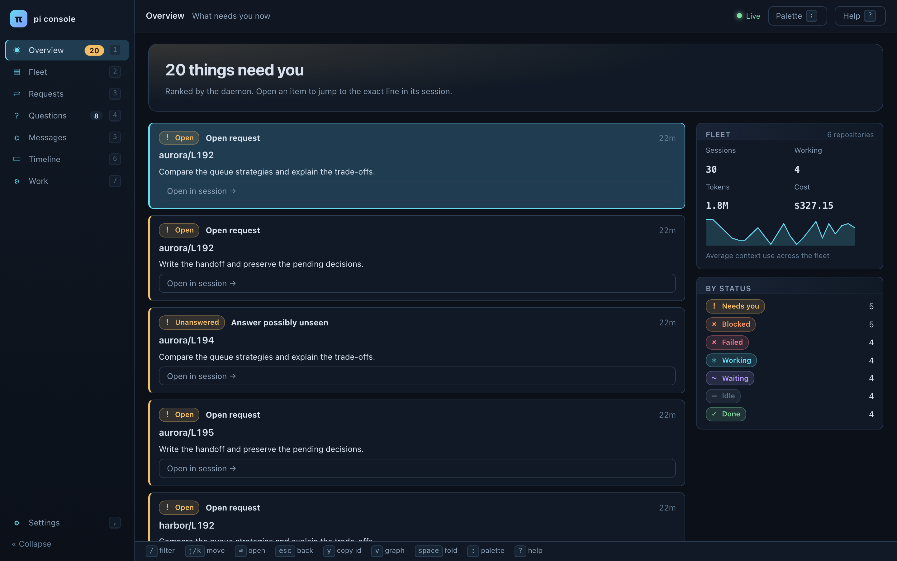 Overview | 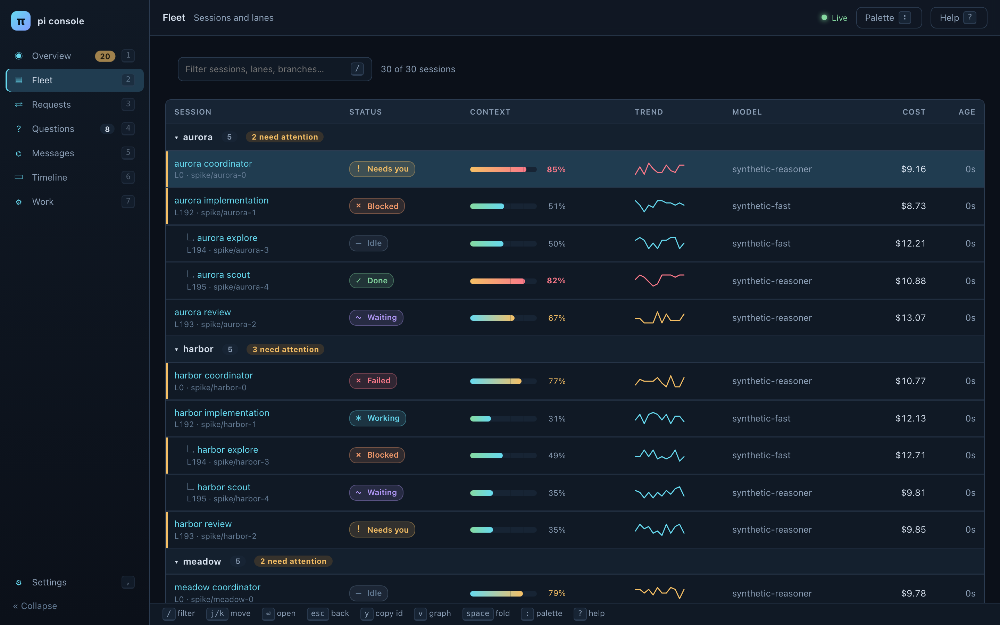 Fleet |
| 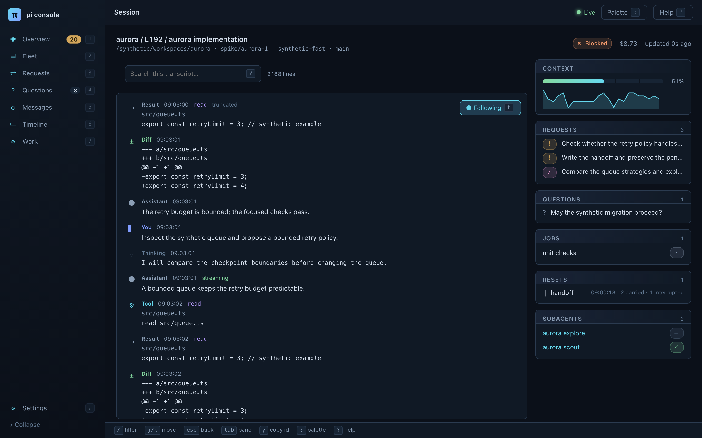 Session | 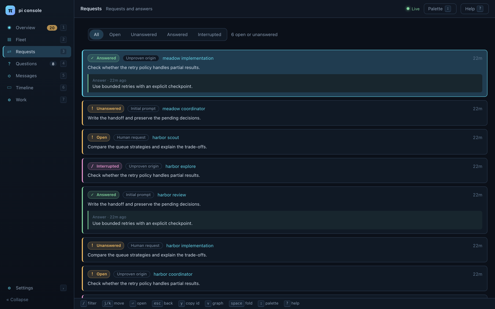 Requests |
| 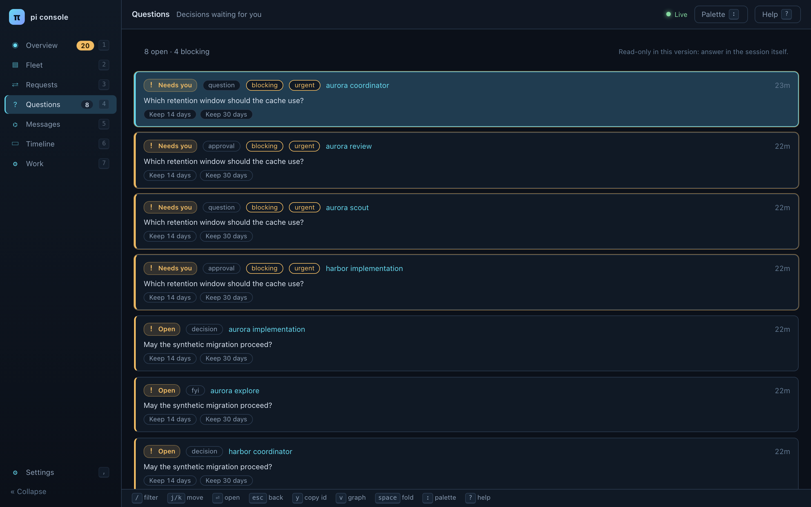 Questions | 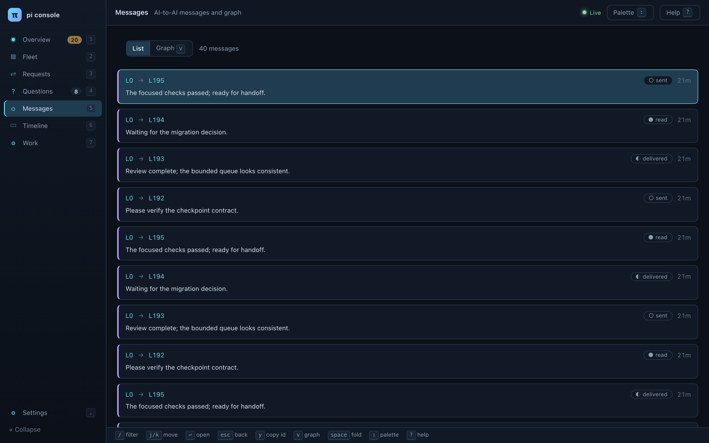 Messages, list |
| 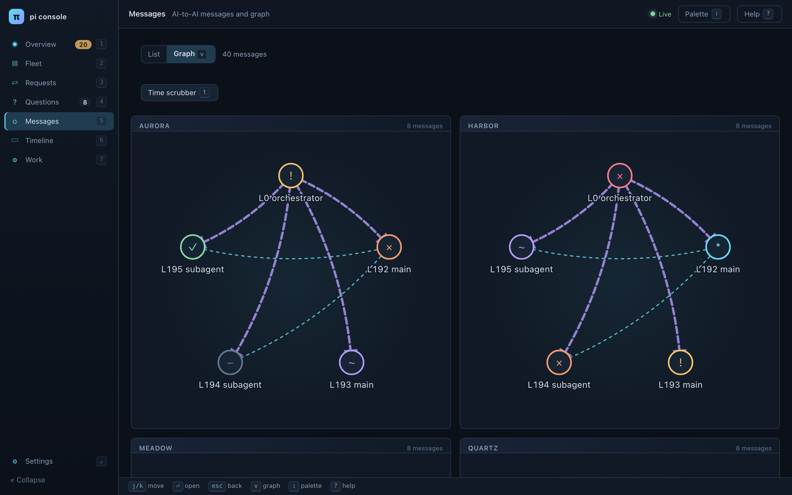 Messages, graph | 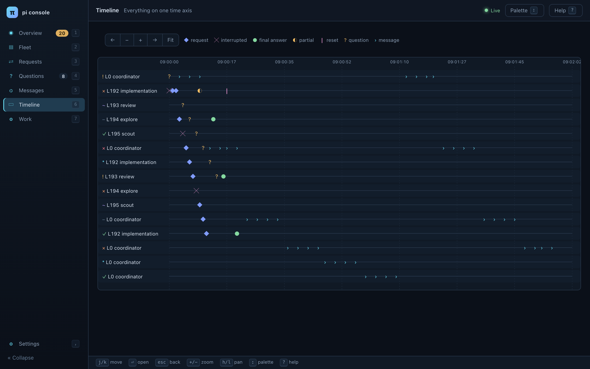 Timeline |
| 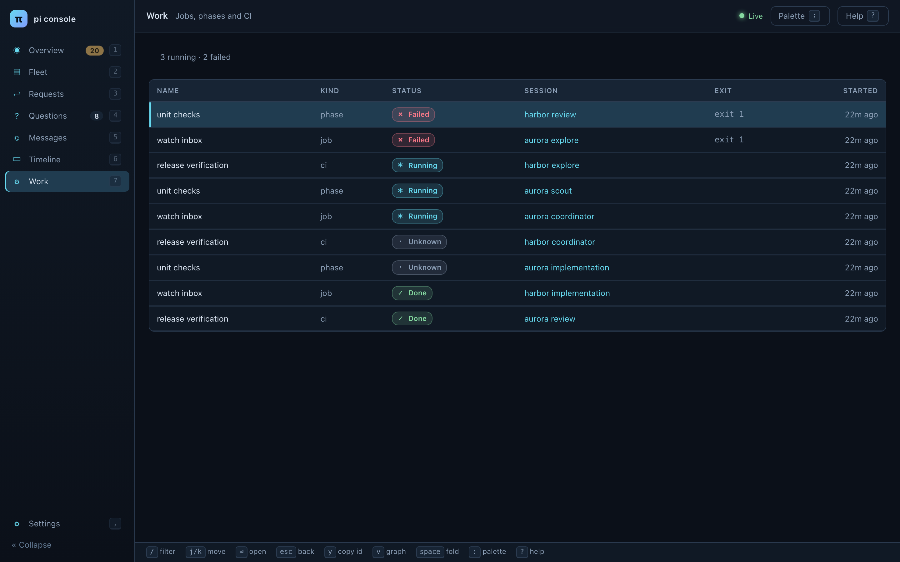 Work | 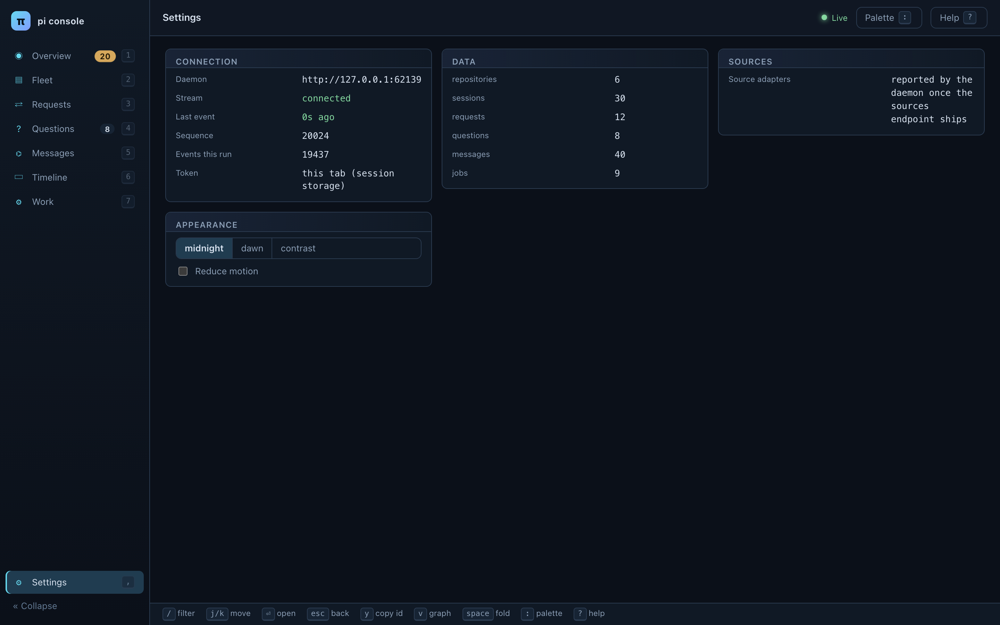 Settings |
| 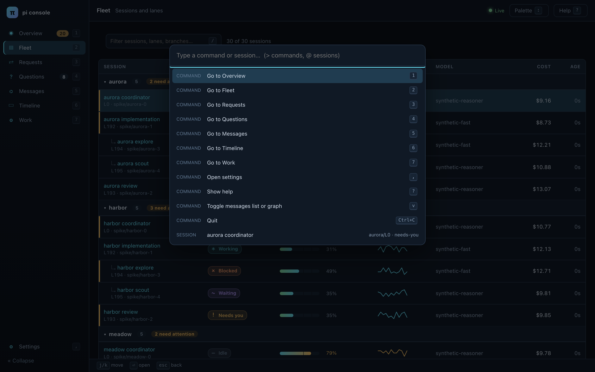 Command palette | 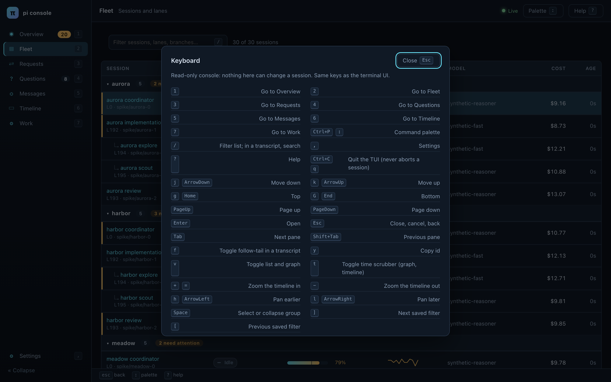 Keyboard help |
| 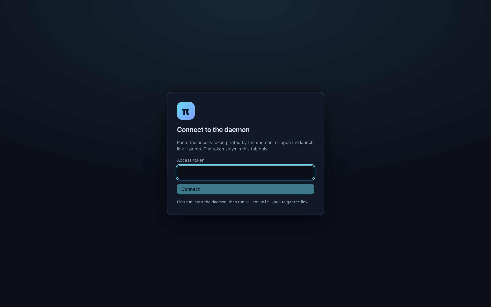 Token screen | 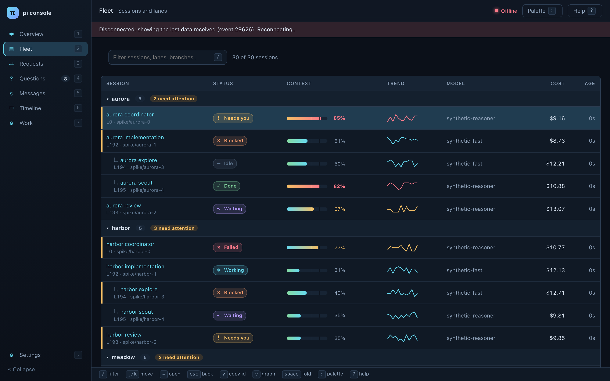 Offline, reconnecting |
