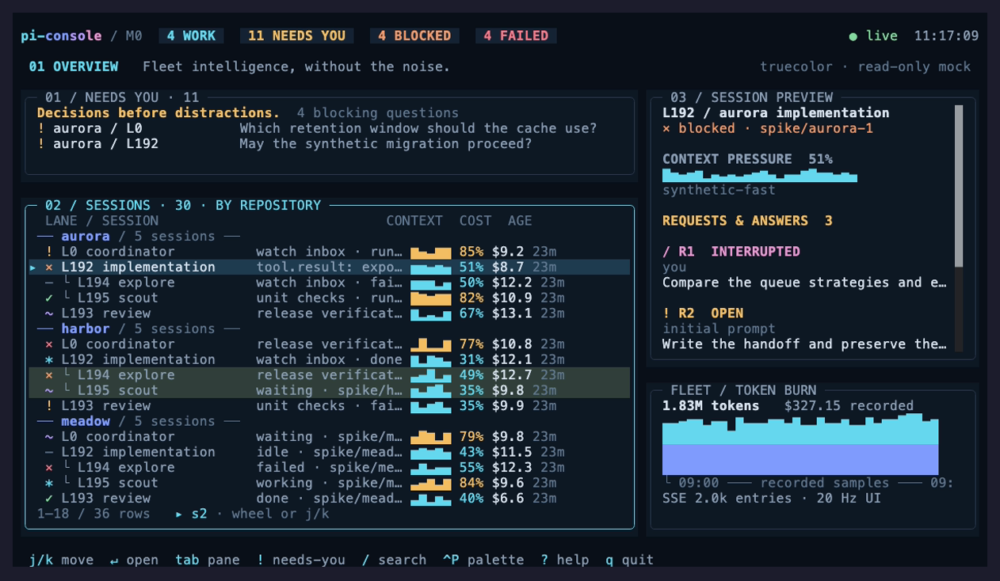
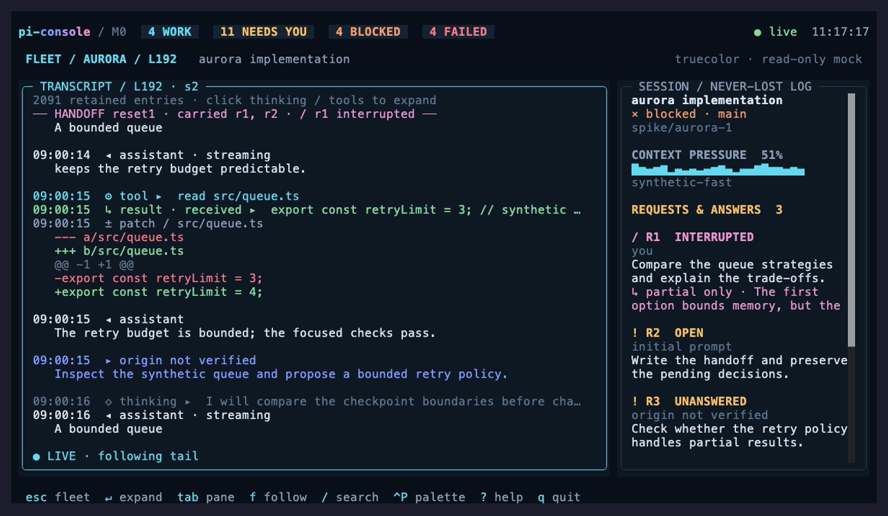

# OpenTUI / React — M0 candidate

A real, read-only Node client of the shared mock daemon. No Bun fallback, screenshots-as-UI, or agent communication. Fleet overview and session detail share the same live projection.




## Run

Requires **Node 26.8+** (native experimental FFI), npm and a supported OpenTUI native binary (tested macOS arm64). From the repository root:

```sh
npm --prefix spikes/tui-opentui install
node spikes/mock-daemon/server.ts
# In another terminal:
npm --prefix spikes/tui-opentui start -- --colors truecolor
```

The token is read from `.pi-console-dev/token`, never put in a URL. `PI_CONSOLE_URL` overrides the loopback URL; `PI_CONSOLE_TOKEN_FILE` overrides the token path. Only loopback HTTP is allowed. No intervention endpoint is called.

`--colors 16|256|truecolor` selects palette quantization. Auto mode uses `COLORTERM`, then `TERM`. The renderer still owns the terminal escape encoding: these switches constrain RGB values, **not** a guarantee of indexed ANSI output on a truly 16-color-only terminal. A high-contrast palette is available in the command palette. Both fallback modes were captured in VHS; 16-color mode is readable but loses most hue distinctions. Status words and symbols remain.

React's DevTools and WebSocket packages are explicit dependencies because the React adapter imports them at startup; no DevTools connection is opened by this client. `tsx` supplies JSX loading. Native imports and the React headless renderer work under Node with `--experimental-ffi`; the experimental warning is expected.

## Navigate

| Key / gesture | Result |
| --- | --- |
| j/k, ↑/↓ | Fleet selection; transcript scroll pauses tail |
| Enter | Open session; expand first visible collapsible block |
| Click | Select fleet row; expand/collapse tool or thinking block |
| Wheel | Move fleet selection or scroll transcript/rail |
| Tab | Switch focused pane; rail accepts native scrolling keys |
| /, text, Enter | Filter fleet names/lanes/repos or search transcript |
| ! | Toggle needs-you fleet filter |
| g / G, End, f | Oldest retained transcript / resume live tail |
| Ctrl+P or : | Fuzzy palette: session jump, fleet, needs-you, theme, quit |
| ? | Help overlay |
| Esc | Close overlay, clear search, then return to fleet |
| q / Ctrl+C | Quit the client, never abort an agent |

The clock ticks independently. Changed session statuses flash briefly. Below 100 columns, the panes stack. At 120 columns the fleet omits the explicit role/token columns to preserve names and activity; at 200 columns it exposes them. The graph is **recorded fixture sample burn**, not a fabricated live token rate; row age is the recorded session duration, not time since today.

## Transcript and truthfulness

- Streaming deltas, plain assistant prose, collapsed thinking/tool calls/results, red/green diff lines, reset markers and a persistent latest-reset summary are distinct blocks.
- The rail preserves interrupted request R1 and its partial answer, open carried R2, and unanswered/unknown-origin R3 independently of transcript retention. Requests retain API provenance; unlinked transcript `user` entries say **origin not verified**.
- The API supplies no tool exit/success field. A result is labelled **received**, not successful. Diffs use the fixture's synthetic `src/queue.ts` header; this is not filesystem inspection.
- Only s2 has a recorded transcript in this fixture. Other sessions explicitly show no transcript rather than recycling s2.
- SSE is decoded incrementally with UTF-8 framing, reconnection and `Last-Event-ID`. Backfill is cursor-based, deduplicated with concurrently arriving live entries, and capped at five pages. Initial backfill is not an archival loader.
- A 2,500-entry ring bounds retention. Live rendering prepares only the last 120 entries and mounts only visible lines. Pausing snapshots retained entries so eviction cannot move the text underneath the reader; a cursor-based new-entry counter continues. Resuming discards the frozen view. Search covers retained text, not all daemon history.
- UI notifications batch at 50 ms. There is no per-delta React update, unconditional full-screen clear, or unbounded rendered scrollback. Terminal controls and bidi overrides in payloads are stripped.

## Captures and performance

`demo.gif` is a real 15.84-second VHS recording: overview → session → paused/following → palette → help. Four PNGs show both screens at **120×36** and **200×50**, confirmed with `stty size` before launch:

- [Overview 120](overview-120.png), [session 120](session-120.png)
- [Overview 200](overview-200.png), [session 200](session-200.png)

Reproduce from the repository root (VHS, ttyd, ffmpeg and Menlo font required; create `.ai-work/` first):

```sh
vhs spikes/tui-opentui/demo.tape
vhs spikes/tui-opentui/capture-wide.tape
node spikes/tui-opentui/benchmark.mjs
```

Measured macOS arm64, Node 26.8.1, OpenTUI 0.9.6, 120×36 real VHS PTY, daemon `--rate 5000`, approximately 25 seconds including detail, pause, follow and palette. After the initial five seconds: **16.90% mean CPU**, **23.05% peak one-second CPU**, **250.0 MiB mean RSS**, **269.25 MiB peak RSS**, **18.17 ms worst one-second event-loop p99**, **19.64 projection updates/s**. CPU is percent of one core using the TUI process's `process.cpuUsage()`; RSS excludes daemon, browser and encoder. Around 100k further entries arrived during the sampled 20 seconds; retention stayed at 2,500. Projection updates are not a measured presented-frame count. The paused and palette screenshots remained correct under load. This is a short spike measurement, not a long-run leak claim.

## Checks

All builds/tests were run through `pi-phase` with the brief's fast/direct policy:

- `npm --prefix spikes/tui-opentui run check` — passed strict TypeScript, no emit.
- `npm test` — passed the root fixture/daemon suite (9 tests).
- `npm --prefix spikes/tui-opentui test` — passed 2 tests: native headless fleet/detail/palette/search/pause/follow/mouse/resize plus projection/formatting/safety.
- `npm --prefix spikes/tui-opentui run test:integration` — passed real authenticated HTTP/SSE/backfill at 5,000 entries/s.
- `node spikes/tui-opentui/benchmark.mjs` — passed the PTY stress capture and reported the measurements above.
- `git diff --check` — passed. No repository CI workflow, formatter, or local gate script was present.
- **Tier 1 is not fully green:** `npm run check` fails in the untouched sibling `spikes/arc-ts/client/generated/All.ts` because the shared strip-only checker rejects TypeScript parameter properties. No sibling files were changed. The checker recursively scans dependency folders too; for the local attempt this candidate's ignored dependencies were moved under `.ai-work/` with a `node_modules` symlink. Normal candidate install/check commands above need no such arrangement. Other sibling spike test suites were not evaluated.

## Candid rubric (1–5)

| Dimension | Score | Assessment |
| --- | --- | --- |
| Visual polish | 4 | Dark layered surfaces, rounded panels, subtle header gradient, restrained accents; much stronger in truecolor. |
| Fleet density | 4 | Grouped hierarchy, attention, charts, preview; role/token columns need the wide layout. |
| Transcript ergonomics | 3 | Fast bounded window, honest provenance, persistent reset context; no full-history loader, Markdown parser or delta coalescing. |
| Streaming performance | 4 | 5k/s stays interactive with 20 Hz batched projection; renderer/React/native baseline is about 250 MiB. |
| Resize / responsiveness | 4 | Real 120×36 and 200×50 captures, automated narrow stacking; extreme tiny sizes and wide Unicode columns are not solved. |
| Keyboard / mouse | 4 | Palette, focus, search, pause/follow, clickable blocks; keyboard expansion targets first visible block rather than a block cursor. |
| Startup / distribution | 2 | Fast TSX startup, but Node 26 FFI and platform-native artifacts complicate packaging and portability. |
| Testability | 4 | Native cell-frame, input/mouse/resize tests and real SSE test; no pixel goldens or long-duration soak. |
| Accessibility | 3 | Text/glyph redundancy and contrast switch; no screen-reader validation, weak 16-color hue separation. |
| Implementation complexity | 3 | Small client/projection and reusable panels; app/transcript state and rendering need decomposition before production. |
| Maintenance / confidence | 3 | React UI is productive; experimental Node FFI and upstream terminal behavior remain material risks. |

Code Health: new files have no prior baseline. Nine source/test/benchmark files scored 10.0; `widgets.tsx` 9.68. **Exceptions:** `app.tsx` 8.4 and `transcript.tsx` 8.1, due to control/render complexity and the timeline's argument list. These two miss the 9.5 target and need uplift, not an unchecked claim of production readiness. They were reviewed; no additional score-chasing rounds were run.

**Recommendation:** keep OpenTUI as a credible high-fidelity candidate. It handles the target stress rate and delivers attractive native terminal panels with good test hooks. Do not select it solely from these screenshots: resolve Node/native distribution, strict palette capability negotiation, long-history navigation and state decomposition first. This spike does not decide against the other stacks.
